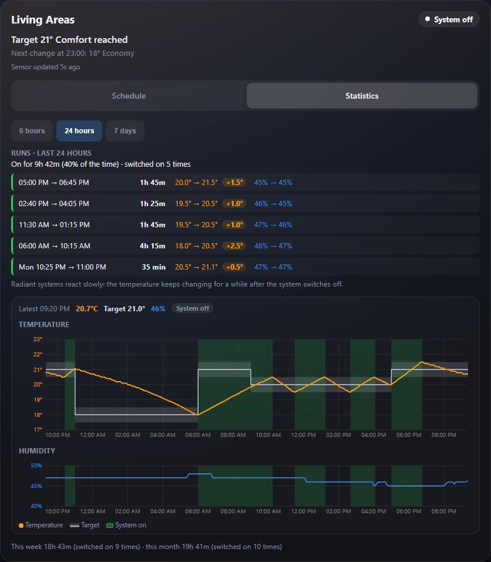

# LocalHome

[](https://github.com/intilinux-eng/LocalHome/actions/workflows/tests.yml)
[](LICENSE)


**Heating, cooling and ventilation for Shelly Gen3 devices - entirely
local, over MQTT.** No Shelly cloud, no hub, no subscription: the
sensors and relays talk to a Mosquitto broker on a small board in the
apartment, and LocalHome runs the thermostat, the schedules and the
dashboard next to it. It runs on an
[Arduino UNO Q](https://www.arduino.cc/product-uno-q), in real
apartments, every day.

It's also a reference for anyone using **Shelly H&T Gen3 sensors on
batteries** over local MQTT: how they really report, how to tell a
sleeping sensor from a dead one, and what the network under them needs
- measured on real devices, written up in
**[docs/shelly-gen3.md](docs/shelly-gen3.md)**.

## Try it in one minute

Every device simulated - no hardware, no broker:

```bash
git clone https://github.com/intilinux-eng/LocalHome.git && cd LocalHome
docker compose -f docker-compose.demo.yml up --build
```

Then open **http://localhost:5000** - two zones with a sample week
painted, an outdoor sensor, the ventilation, a bathroom bypass valve and
a dehumidifier - and **http://localhost:5000/climate-admin**, where each
of them can be switched to a real Shelly id. `docker compose -f
docker-compose.demo.yml down -v` starts it over.

Without Docker (Python 3.10 or later):

```bash
python3 -m venv .venv && .venv/bin/pip install -e . -c constraints.txt
cp -r demo/config /tmp/localhome-demo
LOCALHOME_CONFIG=/tmp/localhome-demo/config.yaml .venv/bin/localhome
```

## Shelly Gen3, local, over MQTT

| Device | Role here | In the field |
|---|---|---|
| **Shelly H&T Gen3**, on batteries | each zone's temperature and humidity; the outdoor sensor | two units, daily |
| **Shelly Dimmer 0/1-10V PM Gen3** | the ventilation unit's (VMC) speed, through its 0-10 V input | one unit, daily |
| Shelly Plus 1 | zone valves, bathroom bypass valve, dehumidifier | supported, not yet in the field |

A few of the things learned on the way - each explained in
[docs/shelly-gen3.md](docs/shelly-gen3.md):

- An H&T Gen3 on batteries reports **at once on a change** past its
  thresholds (0.5 °C and 1% at the tightest) and **every 2 hours
  regardless** - to within about a minute. Each report carries the exact
  reading, to 0.1 °C.
- Its status topics are **not retained**, and its `online` topic reads
  `false` nearly all the time, because it sleeps. Keep the last reading
  across restarts; judge the sensor by its heartbeat, never by `online`.
- A **weak signal isn't a fault** in itself: a sensor at -85/-90 dBm has
  kept every report on time for weeks. Lost reports are what to act on -
  counted without blaming the sensor for time the board was off.
- The dimmer publishes its state only on change: it's **asked**, over
  RPC on MQTT - and it silently ignores a fractional brightness.
- The router matters more than the devices: Wi-Fi clients must reach
  each other, and 5 GHz belongs on a fixed non-radar channel.

The admin panel shows what every Shelly says about itself: signal now
and over a day and a week, battery, reports lost, internal temperature,
mains voltage, restarts and firmware updates.

## What it does

- **A thermostat per zone** - valves driven by a weekly schedule painted
  with a drag, separate winter and summer weeks, a temporary target
  ("22° for two hours") from the zone's card, away mode, and a zone that
  can sit out the summer. A silent sensor closes its valve after a day
  instead of leaving it open forever.
- **The rest of the plant** - a bathroom bypass valve and a dehumidifier
  following per-season rules, the ventilation's speed on a weekly
  program with a timed boost, an outdoor sensor.
- **Statistics** - every run of the last day or week, with what the
  temperature and humidity did meanwhile, in a SQLite history on the
  board.
- **An admin panel for installers** (`/climate-admin`) - map the zones
  and roles onto the Shelly ids of *this* apartment from the browser,
  every device simulated until its hardware is in, plain-language status
  and problems, the board's health, and a diagnostics download.
- **Built to run for years unattended** - watchdogs for the Wi-Fi, the
  service and the hardware, a budget on writes to the board's soldered
  eMMC, history paused until the clock is right, dependencies pinned to
  the versions tested together.
- **A status display on the board itself** - the UNO Q's LED matrix, for
  whoever stands in front of it without a phone.

English and Italian UI; optional HTTP Basic Auth.

## Screenshots

Captured against the simulated devices - what the demo shows.

| Home | Heating & Cooling |
|---|---|
|  |  |


*A zone's statistics: when the system ran, and what it did.*


*The admin panel.*

## Built on the Arduino UNO Q

LocalHome uses both halves of the board:

| Side of the board | What runs there |
|---|---|
| **Linux** - Qualcomm QRB2210, Debian 13 | LocalHome itself: dashboard, admin panel, thermostat, schedules, the SQLite history. Next to it the Mosquitto broker the Shellys report to, and avahi, which makes the board reachable as `<name>.local`. |
| **Microcontroller** - STM32U585 | A small sketch ([deploy/led-matrix](deploy/led-matrix/localhome_matrix/localhome_matrix.ino)) drawing LocalHome's status on the 13×8 LED matrix, fed through the board's own Linux-to-MCU bridge. |

What it costs the board, measured on a UNO Q in daily use:

| | |
|---|---|
| LocalHome's memory | about 110-120 MB of 4 GB (capped at 512 MB) |
| CPU | under 2% of one core |
| eMMC writes | about 0.25-0.6 GB a day, after [`deploy/tune-board.sh`](deploy/tune-board.sh) |
| Power-on to dashboard | about 40 seconds |

Any other Linux board (a Raspberry Pi, ...) runs it too - the LED matrix
just stays off.


The matrix shows health, not data: the season and one bar per zone
(bright while its valve is open); a blinking `!` with a two-letter code
when something's wrong (`S1` zone 1's sensor is silent, `MQ` the broker
is down, `RT` the router isn't passing the devices' traffic...); the
board's IP address at start-up and the page's name every few minutes.
The microcontroller also draws on its own - a
blinking X if LocalHome stops sending for 20 seconds - so it still says
something when the network or LocalHome is down. The admin panel
mirrors it live and explains every code.

## Install on an Arduino UNO Q

From a board fresh out of its box to a running installation in about 15
minutes. The full, verified walk-through - every command, what it
prints, and what to do when it doesn't - is
**[docs/quick-installation-arduino-uno-q.md](docs/quick-installation-arduino-uno-q.md)**.
In short, with the board on your Wi-Fi and its name set (Arduino App Lab
does both at first boot), over `ssh arduino@<name>.local`:

```bash
# 1. Time zone - the board ships in UTC, and schedules run on its clock
sudo timedatectl set-timezone Europe/Rome

# 2. Packages
sudo apt-get update
sudo apt-get install -y mosquitto python3.13-venv libnss-mdns

# 3. The MQTT broker, open to the Shelly devices on the LAN
printf 'listener 1883\nallow_anonymous true\n' | sudo tee /etc/mosquitto/conf.d/localhome.conf
sudo systemctl restart mosquitto

# 4. LocalHome, with the dependency versions it was tested with
git clone https://github.com/intilinux-eng/LocalHome.git ~/localhome && cd ~/localhome
python3 -m venv .venv && .venv/bin/pip install -e . -c constraints.txt

# 5. An empty configuration - devices are added from the admin panel
printf 'web:\n  host: "0.0.0.0"\n  port: 5000\n  language: "it"\n\nintegrations: []\n' > config/config.yaml
printf '{\n  "host": "localhost",\n  "port": 1883\n}\n' > config/mqtt_broker.json
.venv/bin/localhome-cli doctor

# 6. Start it at every boot
sed "s/YOUR_USER/$USER/g" deploy/localhome.service | sudo tee /etc/systemd/system/localhome.service > /dev/null
sudo systemctl daemon-reload && sudo systemctl enable --now localhome

# 7. Tune the board for years of unattended running on its eMMC
sudo sh deploy/tune-board.sh

# 8. The LED matrix: the sketch's library (only if `arduino-cli lib list`
#    doesn't show it already), then build and load it - one build at a time
arduino-cli lib install "Arduino_RouterBridge@0.4.3"
arduino-cli compile --upload -b arduino:zephyr:unoq deploy/led-matrix/localhome_matrix
```

Then open `http://<name>.local:5000/climate-admin`: name the page, set
up the zones - they start simulated, so the whole system can be tried
before any hardware is installed - and switch each device to its Shelly
id as it goes in. On each Shelly: MQTT server `<name>.local:1883`,
"Generic status update over MQTT" and "RPC over MQTT" on - see
[docs/shelly-gen3.md](docs/shelly-gen3.md#mqtt-settings-that-work).
Limits, tuning and what to expect over years of unattended running:
[docs/arduino-uno-q.md](docs/arduino-uno-q.md). Docker and plain
systemd on any Linux: [docs/deployment.md](docs/deployment.md).

Nothing under `config/` other than the `*.example.*` files is ever
committed - see [.gitignore](.gitignore): your device ids, keys and
passwords stay out of git.

## Beyond Shelly

The climate side is Shelly-first, but the drivers underneath are
generic, and a few other devices run in the same apartment:

| Kind | Driver | Talks to | Local? |
|---|---|---|---|
| `cover` / `climate` / `power_meter` / `switch` / `number` | `mqtt_json` | **Anything publishing JSON over MQTT** - Shelly, Tasmota, Zigbee2MQTT, ESPHome, your own sketch | Yes - see [docs/integrations/mqtt.md](docs/integrations/mqtt.md) |
| `switch` / `number` | `shelly_light` | Shelly Gen2/Gen3 dimmers, over RPC on MQTT | Yes |
| `cover` | `tuya_curtain_switch` | Tuya curtain switches (e.g. LoraTap roller shutter modules) | Yes (LAN) |
| `climate` | `tuya_air_quality` | Tuya 9-in-1/12-in-1 air-quality sensors | Yes (LAN) |
| `switch` / `number` | `tplink_led_strip` | TP-Link Kasa/Tapo LED strips, found again by MAC when their IP changes | Yes (LAN) - see [docs/integrations/tplink.md](docs/integrations/tplink.md) |
| `power_meter` | `ewelink_powct` | Sonoff POWCT | No - eWeLink cloud, see [docs/integrations/ewelink.md](docs/integrations/ewelink.md) |
| `switch` | `meross_plug` | Meross smartplugs | No - Meross cloud, see [docs/integrations/meross.md](docs/integrations/meross.md) |
| `climate` / `switch` / `number` | `simulated` | **No hardware** - try a whole setup before owning it | - see [docs/integrations/simulated.md](docs/integrations/simulated.md) |
| `notifier` | `telegram` | Telegram bot API | Cloud by nature |

Adding a driver is a self-contained change - see
[docs/adding-a-driver.md](docs/adding-a-driver.md).

## How it's organized

```
config/            Your config.yaml, device inventories and secrets (gitignored, except *.example.*)
demo/config/       The demo: every device simulated
src/localhome/
  core/            Driver interfaces, the plugin registry, background pollers
  drivers/         One subpackage per brand/protocol (mqtt, tuya, tplink, meross, ewelink, simulated, ...)
  services/        Thermostat, schedules, interlocks, history, Shelly health, system status, LED matrix
  web/             Flask app, templates, static files, locales/
tests/             Unit tests (no hardware, no network) and browser tests (tests/ui)
deploy/            systemd unit, board tuning, watchdogs, the LED matrix sketch, the resource log
```

See [ARCHITECTURE.md](ARCHITECTURE.md) for how the pieces fit together.

## Documentation

- [docs/shelly-gen3.md](docs/shelly-gen3.md) - **Shelly Gen3 over local MQTT: field notes** (H&T on batteries, the dimmer, the network)
- [docs/quick-installation-arduino-uno-q.md](docs/quick-installation-arduino-uno-q.md) - a new Arduino UNO Q from the box to a running installation
- [docs/arduino-uno-q.md](docs/arduino-uno-q.md) - the reference installation: limits, tuning, updating
- [docs/configuration.md](docs/configuration.md) - every `config.yaml` option, and the admin panel
- [docs/integrations/](docs/integrations/) - per-brand guides (MQTT, Tuya, TP-Link, Meross, eWeLink, Telegram, simulated)
- [docs/deployment.md](docs/deployment.md) - Docker, systemd, addressing by name, pinned versions
- [docs/troubleshooting.md](docs/troubleshooting.md) - known error messages and fixes
- [ARCHITECTURE.md](ARCHITECTURE.md), [docs/adding-a-driver.md](docs/adding-a-driver.md), [CONTRIBUTING.md](CONTRIBUTING.md)
- [CHANGELOG.md](CHANGELOG.md), [THIRD_PARTY_NOTICES.md](THIRD_PARTY_NOTICES.md)

## How it was built

LocalHome was built by one person directing an AI coding agent
([Claude Code](https://claude.com/claude-code)) - which is why nearly
every commit carries a `Co-Authored-By: Claude` line. The code was
written in conversation; the decisions, the installation and the
testing in two real apartments were not:

- **Every change is tested.** Over 650 unit tests, with no hardware and
  no network, and browser tests driving a real Chromium at phone and
  desktop widths - all run by CI on every push.
- **Nothing is claimed that wasn't measured on the board.** Memory,
  eMMC writes, report timings, signal levels: the numbers in these
  docs come from the devices, and the docs say where they don't.
- **The field decides.** Most of the robustness in here - watchdogs,
  lost-report counting, finding strips by MAC, the router checks -
  exists because something went wrong in a real apartment first, and
  was then reproduced, fixed, tested and written down.
- **Small commits, written for a reader.** Each says what changed and
  why; [CHANGELOG.md](CHANGELOG.md) tells the story at a higher level.

## Why this exists

Cloud-dependent smart-home apps break when the vendor's server has a bad
day, get discontinued when the vendor loses interest, and cost more
(subscriptions, hubs) than the gadgets they control. Shelly devices
already speak MQTT on the LAN; LocalHome is the smallest thing that
turns a handful of them into a heating and cooling system someone can
live with - and hand over to the next apartment.

## Legal & licensing

LocalHome is [MIT licensed](LICENSE). Its dependencies are permissive
(MIT/BSD/Apache) except `python-kasa` (GPL-3.0-or-later), pulled in only
by the opt-in `[tplink]` extra - see
[THIRD_PARTY_NOTICES.md](THIRD_PARTY_NOTICES.md#a-note-on-python-kasa-specifically).
The `ewelink_powct` driver relies on unofficial eWeLink app credentials,
not sanctioned by Coolkit/eWeLink - see
[THIRD_PARTY_NOTICES.md](THIRD_PARTY_NOTICES.md#a-note-on-the-ewelink-driver-specifically).

This project is not affiliated with, endorsed by, or sponsored by Shelly
(Allterco), Arduino, Tuya, LoraTap, Sonoff, Coolkit/eWeLink, Meross,
TP-Link or Telegram. All trademarks belong to their respective owners.
