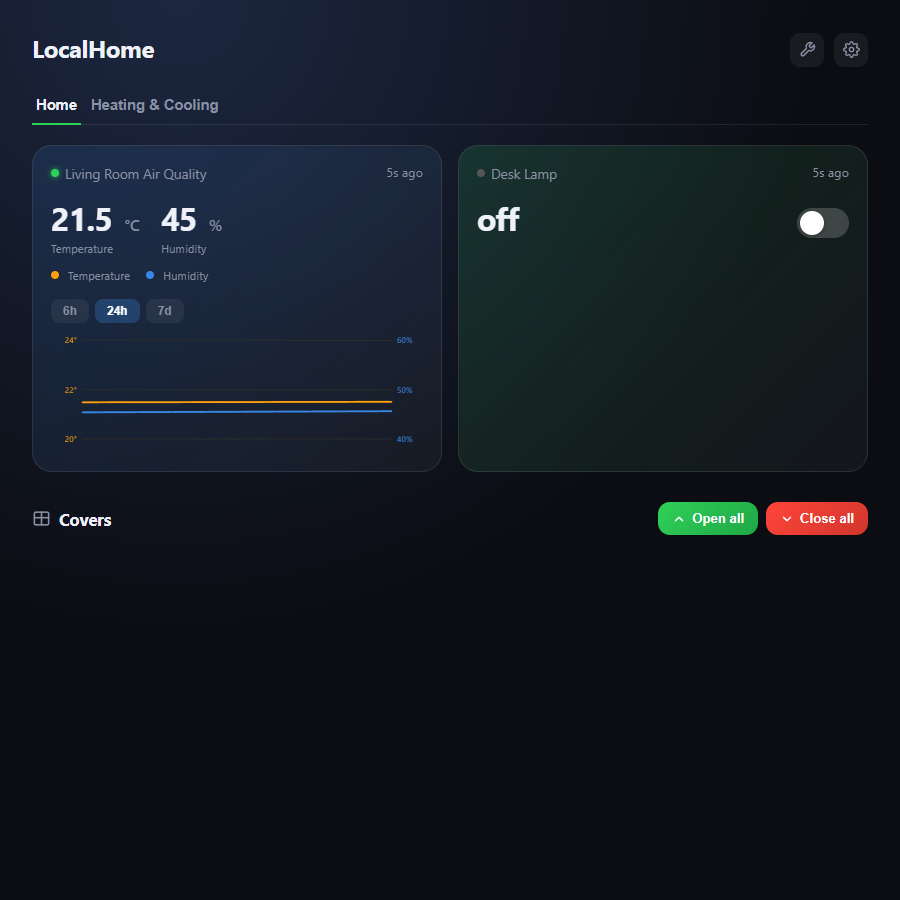

# LocalHome

A small, local-first framework for automating a home with cheap smart
devices - roller shutters, power meters, climate/air-quality sensors,
smart plugs - **without a hub, without a subscription, and without your
data leaving your network unless one specific device forces it.**

Most drivers talk to devices directly over your LAN. A couple of
device families only expose their data through their vendor's cloud API
(there's no usable local protocol) - those are clearly called out, and
everything else keeps working if they're down.

This isn't a hardware-agnostic platform like Home Assistant; it's a much
smaller, hackable base meant to be read end to end in one sitting and
extended with exactly the drivers your home needs. If you outgrow it,
you've outgrown it - that's a fine outcome for a project this size.

## Screenshots

All three captured against the `simulated` driver and example device
ids (see below) - no real hardware needed to see this for yourself.

| Home | Heating & Cooling |
|---|---|
|  |  |


*Climate admin panel - see [below](#the-shelly-climate-admin-panel).*

## What's included

| Kind          | Driver                | Talks to                          | Local? |
|---------------|------------------------|------------------------------------|--------|
| `cover`       | `tuya_curtain_switch`  | Tuya-based curtain switches (e.g. LoraTap WiFi roller shutter modules) | Yes (LAN) |
| `climate`     | `tuya_air_quality`     | Tuya 9-in-1/12-in-1 air-quality sensors | Yes (LAN) |
| `power_meter` | `ewelink_powct`        | Sonoff POWCT power-monitoring relay | No - eWeLink cloud only, see [docs/integrations/ewelink.md](docs/integrations/ewelink.md) |
| `switch`      | `meross_plug`          | Meross smartplugs                  | No - Meross cloud (MQTT), see [docs/integrations/meross.md](docs/integrations/meross.md) |
| `switch` / `number` | `tplink_led_strip` | TP-Link Kasa/Tapo LED strips (on/off + brightness) | Yes (LAN) - see [docs/integrations/tplink.md](docs/integrations/tplink.md) |
| `cover` / `climate` / `power_meter` / `switch` / `number` | `mqtt_json` | **Generic** - any device that publishes JSON (or plain-string) state over MQTT: Shelly, Tasmota, Zigbee2MQTT, ESPHome, DIY sketches... | Yes (LAN, to your own broker) - see [docs/integrations/mqtt.md](docs/integrations/mqtt.md) |
| `climate` / `switch` | `simulated`       | **No hardware required** - a fake sensor/switch for trying out the dashboard (or a whole thermostat setup) before you own the real thing | N/A - see [docs/integrations/simulated.md](docs/integrations/simulated.md) |
| `notifier`    | `telegram`             | Telegram bot API                   | Cloud by nature (push notifications) |

`number` is a controllable analog value - a dimmer, a fan speed, a 0-10V
output - for anything set to a level rather than toggled or driven
open/closed.

The web dashboard has two tabs.

**Home** - whatever combination of the devices above you have enabled,
plus estimated 0-100% position for covers that only report a raw
open/close/stop motor command, a sqlite-backed history/chart (with
automatic old-row cleanup) for any numeric field a driver exposes, and
an optional power-budget alert.

**Heating & Cooling** - a multi-zone valve thermostat for a
shared-plant radiant-panel setup (or anything similar): a
click-and-drag weekly setpoint schedule per zone, editable straight
from the dashboard; how many hours each zone's valve was on
today/this week/this month; a one-tap "away for N days" override that
closes every valve and resumes the normal schedule on its own; a zone
that can opt out of one mode entirely (e.g. a bathroom that can't
safely be cooled); and a generic "switch A forces switch B" rule for a
device whose own operation depends on a specific valve (e.g. a
dehumidifier sharing a zone's water circuit). See
[docs/configuration.md#thermostat-heatingcooling-zones](docs/configuration.md#thermostat-heatingcooling-zones) -
and if every zone happens to be on Shelly hardware, see
[the climate admin panel](#the-shelly-climate-admin-panel) below for
configuring it from a browser instead of by hand.

Both tabs get optional HTTP Basic Auth (off by default) and a UI
language switchable with one config line - English and Italian ship
today; see [docs/configuration.md#language](docs/configuration.md#language)
for adding your own.

Don't own any of the devices above? The point of this project is that
adding your own driver is a self-contained, half-hour change - see
[docs/adding-a-driver.md](docs/adding-a-driver.md).

## The Shelly climate admin panel

A dedicated `/climate-admin` page for the two-zone heating/cooling
thermostat, built around one specific, common deployment: the exact
same setup (two radiant-panel zones, one shared plant) installed
across multiple homes that all standardize on the [Shelly](https://www.shelly.com/)
device family (Gen3 H&T sensors, Plus 1 relays) - where redeploying to
a new home should only ever mean typing in that home's own device ids,
never touching code or config.yaml by hand. See
[docs/configuration.md#the-shelly-climate-admin-panel](docs/configuration.md#the-shelly-climate-admin-panel)
for the full picture; in short, from the browser alone:

- Map each zone's sensor to a real Shelly device, a simulated one (no
  hardware installed yet), or a manually-typed debug value - and its
  valve to a real relay or a simulated one - so the on/off control
  logic can be verified end to end (including manual open/close test
  buttons) before any hardware is actually wired.
- Edit the MQTT broker connection and two more fixed Shelly Plus 1
  switches (a bathroom bypass valve, a dehumidifier) - a full install
  needs no file editing at all.
- A live status view with plain-language guidance that tells a
  battery sensor that simply hasn't reported yet apart from one that's
  genuinely gone offline, a broker-reachability check kept separate
  from per-device status (so a dead broker is never mistaken for six
  dead devices at once), and a "Restart LocalHome" button so a change
  can be applied from just a browser.

## Tested hardware

Driver *code* should work with any device of the right product
category/protocol version, but here's specifically what this project
runs against day to day:

| Device | Driver | Details |
|--------|--------|---------|
| LoraTap WiFi Roller Shutter Switch | `tuya_curtain_switch` | Tuya "Curtain switch" product (`product_id nnfrmb3val45av1n`, model `qcsc500wv2n2`), category `clkg`, tinytuya protocol v3.4. Several units running continuously. |
| A Tuya 9-in-1 air-quality/climate sensor | `tuya_air_quality` | Product family "9in1/12in1/14in1" (model `QTF-A+C`, `product_id b7alv1ety7u19i9d`), category `hjjcy`, tinytuya protocol v3.5. |
| Sonoff POWCT power-monitoring relay | `ewelink_powct` | Via the eWeLink cloud v2 API - see [docs/integrations/ewelink.md](docs/integrations/ewelink.md) for why this one isn't local. |
| Meross MSS310 smartplug (energy monitoring) | `meross_plug` | Via the official `meross-iot` library (HTTP login + MQTT), using its `ElectricityMixin` for live power/voltage/current. |
| Shelly H&T Gen3 (battery temperature/humidity sensor) | `mqtt_json` | Two topics (`status/temperature:0`, `status/humidity:0`) merged into one reading via a list `state_topic`, plus its `status/devicepower:0` (battery %) and `status/wifi` (signal strength) components - see [docs/integrations/mqtt.md](docs/integrations/mqtt.md). |
| Shelly Plus 1 (relay, mains-powered) | `mqtt_json` | The generic Gen2+ JSON-boolean shape (`status/switch:0`/`command/switch:0`) - used for both zone valves and the climate admin panel's two extra switches. |
| Shelly 0/1-10V Dimmer Gen3 | `shelly_light` | Doesn't publish a retained status topic like the devices above - actively polled via RPC (`Light.GetStatus`/`Light.Set`) instead; see "Shelly components without a retained status topic" in [docs/integrations/mqtt.md](docs/integrations/mqtt.md). |

If you run a driver against different hardware in the same product
family and it works (or doesn't), a PR adding a row here - or opening an
issue with the model/product_id - is genuinely useful to the next
person.

## Quick start

```bash
git clone <this-repo>
cd <the-cloned-directory>

python3 -m venv .venv
source .venv/bin/activate      # Windows: .venv\Scripts\activate
pip install -e .

cp config/config.example.yaml config/config.yaml
# also copy the *.example.json files you need next to it and fill them in -
# see docs/configuration.md and docs/integrations/ for how to get each
# device's IDs/keys/credentials.

localhome-cli doctor   # sanity-checks config.yaml - see docs/configuration.md
localhome
# -> dashboard at http://localhost:5000
```

Always into a virtual environment, never with a bare `pip install`
against the system Python - modern Debian/Ubuntu actively refuse the
latter (`externally-managed-environment`), and some also don't ship
the venv module by default (`python3 -m venv` failing with "ensurepip
is not available") - see [docs/troubleshooting.md](docs/troubleshooting.md)
if you hit either.

Nothing under `config/` other than the `*.example.*` files is ever meant
to be committed - see [.gitignore](.gitignore). That's what keeps your
own device inventory, API keys and account passwords out of git while
this framework itself stays fully public.

Rather run the script directly than install the `localhome` command?
`python run.py` works the same way once the `pip install -e .` step
above has run (it needs the dependencies either way, just not the
console-script entry point).

Want this running unattended on a dedicated device (an
[Arduino UNO Q](https://www.arduino.cc/), a Raspberry Pi, or similar
small Linux board next to your router) instead of a dev machine? See
[docs/deployment.md](docs/deployment.md) for Docker and systemd
options - this project's own day-to-day instance targets an Arduino
UNO Q.

## How it's organized

```
config/            Your device inventories, secrets and config.yaml (gitignored, except *.example.*)
src/localhome/
  core/            Driver interfaces, the plugin registry, background pollers
  drivers/         One subpackage per brand/protocol (tuya, ewelink, meross, mqtt, simulated, notifiers, ...)
  services/        Cross-driver logic: cover position estimation, sqlite history + alerting, the heating/cooling thermostat, and its switch-follows-switch interlock
  web/             Flask app (+ optional Basic Auth), dashboard templates/static files, and locales/ (UI language files, see docs/configuration.md#language)
  config.py        Loads config.yaml and resolves its relative paths
  cli.py           Command-line cover control
docs/              Full documentation (see below)
tests/             Hardware-independent unit tests
deploy/            systemd unit example; see also Dockerfile/docker-compose.yml at the repo root
```

See [ARCHITECTURE.md](ARCHITECTURE.md) for how these pieces fit together
and why they're split this way.

## Documentation

- [ARCHITECTURE.md](ARCHITECTURE.md) - the driver/registry/manager design and why it looks like this
- [docs/configuration.md](docs/configuration.md) - full config.yaml reference, including optional web auth
- [docs/adding-a-driver.md](docs/adding-a-driver.md) - how to add a new brand or device kind
- [docs/integrations/](docs/integrations/) - per-brand setup guides (Tuya, eWeLink, Meross, MQTT, Telegram, Simulated)
- [docs/deployment.md](docs/deployment.md) - Docker / systemd for running this unattended
- [docs/troubleshooting.md](docs/troubleshooting.md) - known error messages and fixes
- [CONTRIBUTING.md](CONTRIBUTING.md) - how to propose changes, coding conventions
- [THIRD_PARTY_NOTICES.md](THIRD_PARTY_NOTICES.md) - dependency licenses and a note on the eWeLink driver

## Why this exists

Cloud-dependent smart-home apps break when the vendor's server has a bad
day, get discontinued when the vendor loses interest, and generally cost
more (subscriptions, hub hardware) than the gadgets they control. Most
cheap WiFi devices already speak a local protocol under the hood -
projects like [tinytuya](https://github.com/jasonacox/tinytuya) simply
expose it. LocalHome is the smallest structure that lets several such
devices, from different brands, show up on one dashboard and share one
history/alerting story, while staying easy enough to read that adding
"one more sensor" stays a small change instead of a rewrite.

## Legal & licensing

LocalHome is [MIT licensed](LICENSE). All of its dependencies (tinytuya,
Flask, aiohttp, meross-iot, requests, PyYAML, paho-mqtt) are under
permissive licenses with no copyleft obligations - see
[THIRD_PARTY_NOTICES.md](THIRD_PARTY_NOTICES.md) for the full list.

One exception worth knowing about explicitly: the `ewelink_powct` driver
talks to eWeLink's cloud using unofficial, reverse-engineered app
credentials (the same pattern the well-known
[AlexxIT/SonoffLAN](https://github.com/AlexxIT/SonoffLAN) project uses) -
not something Coolkit/eWeLink issued to this project or sanctioned. It's
common practice in this space, but it's not a license grant from them,
and skipping that one integration keeps everything else on unambiguous
footing (your own Tuya/Meross developer accounts, standard SDK usage).
See [THIRD_PARTY_NOTICES.md](THIRD_PARTY_NOTICES.md#a-note-on-the-ewelink-driver-specifically)
for the full explanation.

This project is not affiliated with, endorsed by, or sponsored by Tuya,
LoraTap, Sonoff, Coolkit/eWeLink, Meross, or Telegram. All trademarks
belong to their respective owners.
