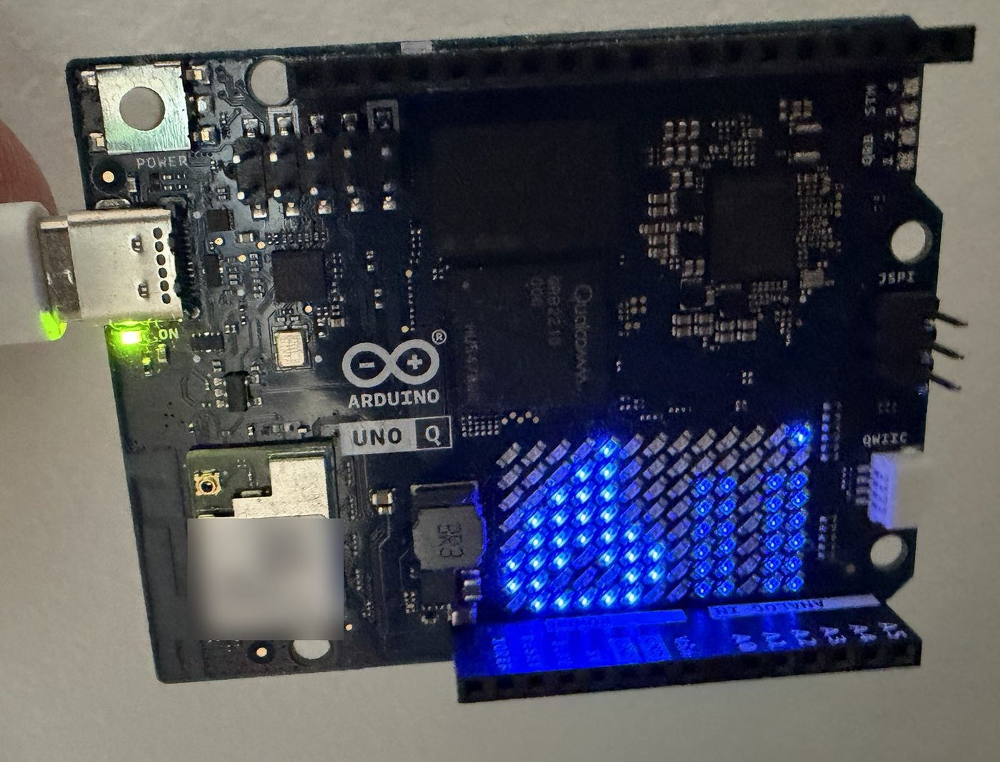
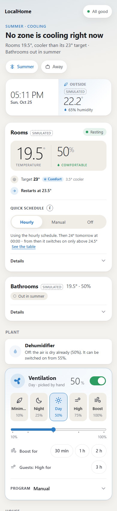
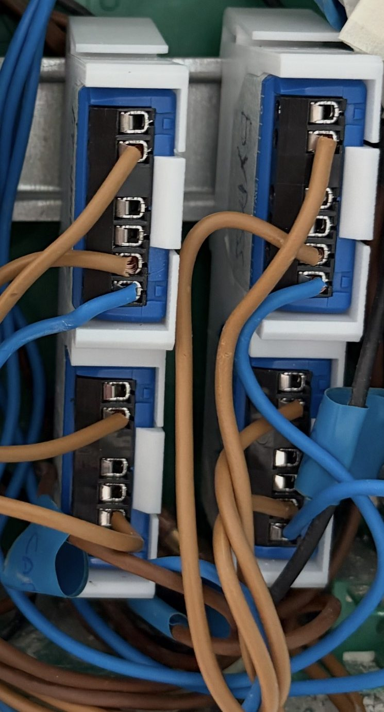
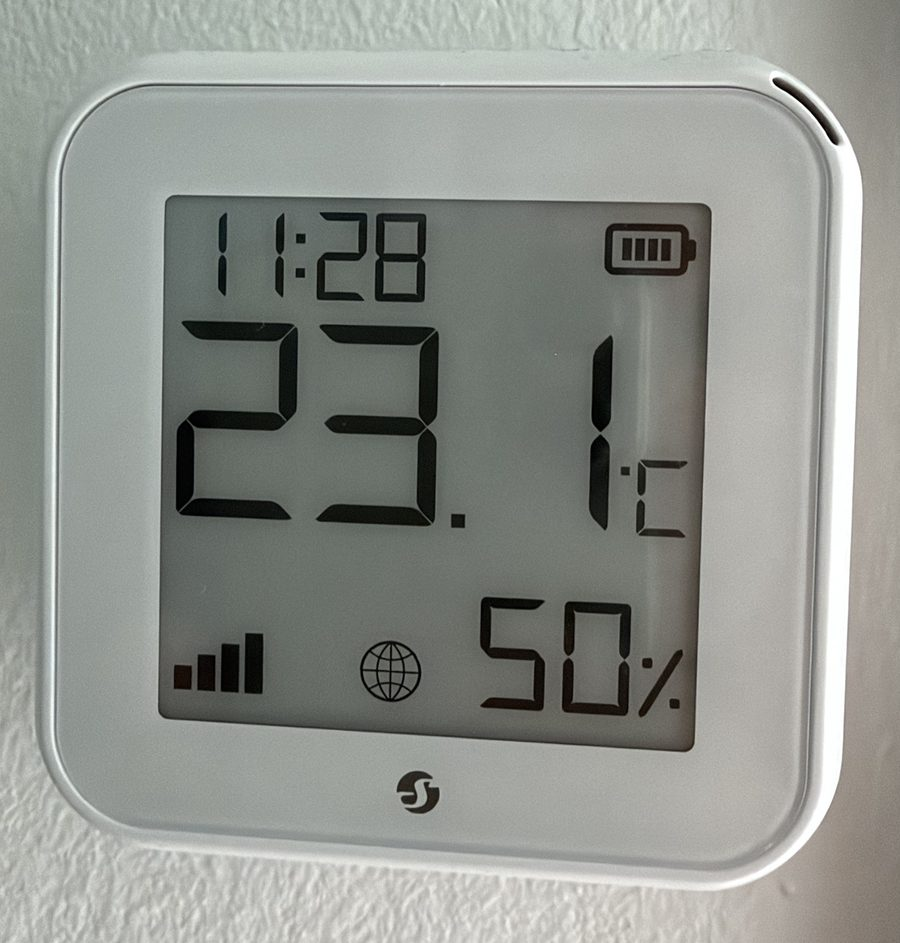
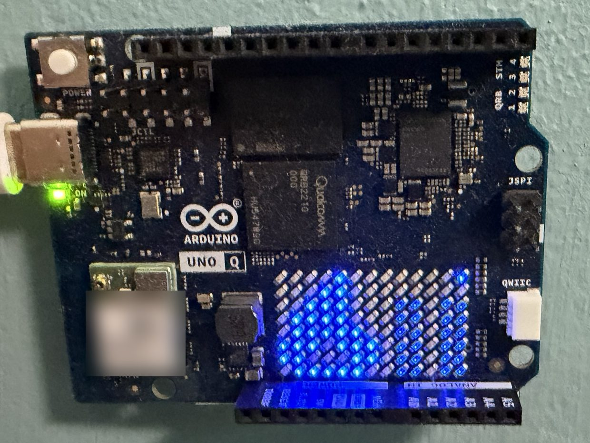
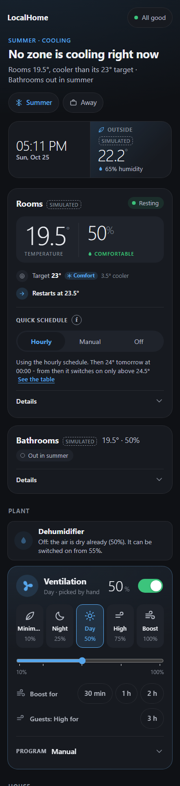
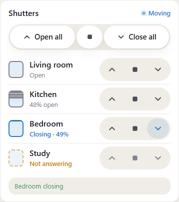
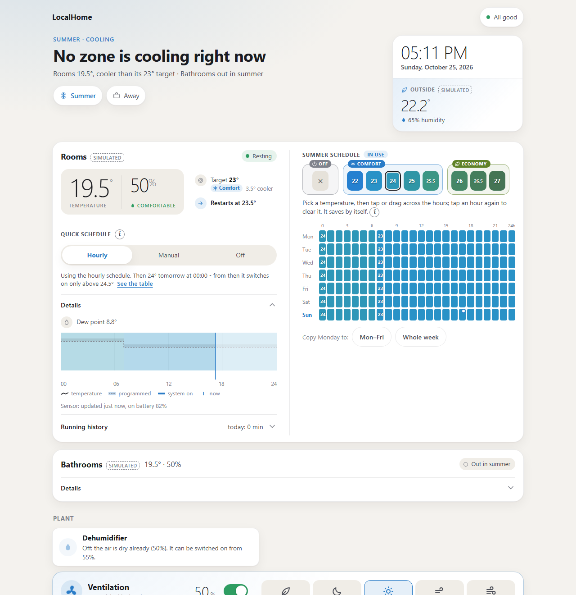
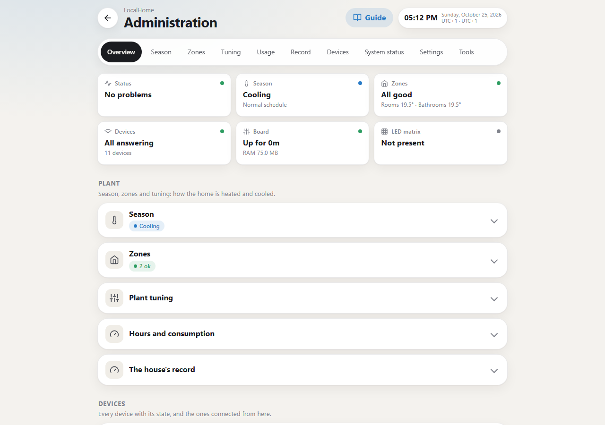

# LocalHome

[](https://github.com/intilinux-eng/LocalHome/actions/workflows/tests.yml)
[](LICENSE)


**The heating, cooling and ventilation of a real apartment in Turin, run
every day by an [Arduino UNO Q](https://www.arduino.cc/product-uno-q) and
a handful of Shelly Gen3 devices - entirely local, over MQTT.** No cloud,
no hub, no subscription: the sensors and relays talk to a Mosquitto broker
on the board, and LocalHome runs the thermostat, the schedules, the
ventilation and the dashboard next to it.

It's that home's system, made to be installed again: two zones on a
radiant ceiling, a bypass valve and a dehumidifier for the summer, a VMC.
A new board starts as that home, every device to configure, and you
adapt it to yours from there - [is it for your home?](#is-it-for-your-home)

<p align="center">
  
  &nbsp;
  
</p>

It's also a field reference for anyone using **Shelly Gen3 devices over
local MQTT** - H&T sensors on batteries above all: how they really report,
how to tell a sleeping sensor from a dead one, and what the network under
them needs, measured on real devices in
**[docs/shelly-gen3.md](docs/shelly-gen3.md)**.

## In daily use, in a home in Turin

Since September 2026 LocalHome has run the climate of an apartment in
Turin, Italy:

- **two zones on a radiant ceiling** - the rooms and the bathrooms -
  heated and cooled by the building's central heat pump, metered per
  apartment;
- **a bathroom bypass valve and a dehumidifier** for the summer;
- **mechanical ventilation (VMC)** on a weekly program, with automatic
  adjustments for a shower, a humid day or air that's too dry;
- **an outdoor sensor** - and, alongside the climate, five roller shutters,
  a power meter and a smart plug.

| Role | Device | In the field |
|---|---|---|
| The board | **Arduino UNO Q**, 4 GB (a 2 GB one tested too) | Debian 13 - LocalHome, Mosquitto, avahi |
| Zone valves, bathroom bypass, dehumidifier | 4 × **Shelly 1 Gen3** (S3SW-001X16EU) | firmware 2.0.1, each with its own safety off-timer |
| Zone and outdoor sensors | 3 × **Shelly H&T Gen3**, on batteries | a report on every change and every 2 hours |
| Ventilation speed | **Shelly Dimmer 0/1-10V PM Gen3** (S3DM-0010WW) | firmware 2.0.1, into the unit's 0-10 V input |
| Alongside | 5 × LoraTap roller shutter modules (Tuya, on the LAN), Sonoff POWCT, Meross plug | optional drivers |

| | | |
|---|---|---|
|  |  |  |
| *The valves' relays* | *A zone's sensor* | *The board on the wall* |

What daily use has shown so far, on this board:

- **About 100 MB of memory** (of 4 GB; LocalHome is capped at 512 MB),
  levelling off after the first days; **under 1% of one CPU core**.
- **About 0.35 GB a day written** to the soldered eMMC, after
  [`deploy/tune-board.sh`](deploy/tune-board.sh) - decades of life.
- **Power cuts, router restarts and a Wi-Fi channel gone bad** were all
  lived through: the board comes back by itself, the devices that drop
  out are named on the home page, and they're picked up again when they
  return.
- **The clock changes** are handled: both 2 o'clocks of the October
  night are in the history, and the schedules ran on time.
- **1,000+ unit tests and 150 browser tests** run on every push.

## Is it for your home?

LocalHome is one home's system, made to be installed again: a new board
starts as that home, every device to configure, and you change it from
there.

**As it is**, it fits a home with:

- two zones, each with a relay-switched valve on its manifold and a
  temperature and humidity sensor in the room - the water heated or
  chilled by a plant LocalHome doesn't drive: a building's central
  plant, or a heat pump with its own controls;
- if it has them, a bathroom bypass valve and a dehumidifier for the
  summer, an outdoor sensor, and a VMC with a 0-10 V speed input.

**From the pages**, with no file to edit: the zones' names and which of
them sits out the summer; each device's Shelly id, typed in as it's
installed - or simulated, to try first; no outdoor sensor, or no VMC;
the schedules, the season, the VMC's program and its adjustments, the
dehumidifier's thresholds.

**In config.yaml, if you have them**: Tuya (LoraTap) roller shutters, a
Sonoff POWCT meter, a Meross plug - each with its card on the home page
only once it's there - and sensors, relays or dimmers of other brands
that speak JSON over MQTT; a zone made of those is wired in config.yaml
instead of the admin panel ([Beyond Shelly](#beyond-shelly),
[configuration](docs/configuration.md#thermostat-heatingcooling-zones)).

**Not yet**: more than two zones from the admin panel, or more than one
sensor in a zone; leaving out the bypass valve or the dehumidifier - a
home without them still lists them as to configure; driving the boiler
or the heat pump itself. Some of it is on the [roadmap](#roadmap).

## Try it in one minute

Every device simulated - no hardware, no broker:

```bash
git clone https://github.com/intilinux-eng/LocalHome.git && cd LocalHome
docker compose -f docker-compose.demo.yml up --build
```

Then open **http://localhost:5000** - two zones with a sample week
painted, an outdoor sensor, the ventilation, a bathroom bypass valve and
a dehumidifier - and **http://localhost:5000/climate-admin**, where each
of them can be switched to a real Shelly id. `docker compose -f
docker-compose.demo.yml down -v` starts it over.

Without Docker (Python 3.10 or later):

```bash
python3 -m venv .venv && .venv/bin/pip install -e . -c constraints.txt
cp -r demo/config /tmp/localhome-demo
LOCALHOME_CONFIG=/tmp/localhome-demo/config.yaml .venv/bin/localhome
```

## Shelly Gen3, local, over MQTT

| Device | Role here | In the field |
|---|---|---|
| **Shelly H&T Gen3**, on batteries | each zone's temperature and humidity; the outdoor sensor | three units, daily |
| **Shelly 1 Gen3** | zone valves, bathroom bypass valve, dehumidifier | four units, daily |
| **Shelly Dimmer 0/1-10V PM Gen3** | the ventilation unit's (VMC) speed, through its 0-10 V input | one unit, daily |
| Shelly Plus 1 | the same roles as the Shelly 1 Gen3 | supported, tested on the bench |

A few of the things learned on the way - each explained in
[docs/shelly-gen3.md](docs/shelly-gen3.md):

- An H&T Gen3 on batteries reports **at once on a change** past its
  thresholds (0.5 °C and 1% at the tightest) and **every 2 hours
  regardless** - to within about a minute. Each report carries the exact
  reading, to 0.1 °C.
- Its status topics are **not retained**, and its `online` topic reads
  `false` nearly all the time, because it sleeps. Keep the last reading
  across restarts; judge the sensor by its heartbeat, never by `online`.
- A **weak signal isn't a fault** in itself: a sensor at -85/-90 dBm has
  kept every report on time for weeks. Lost reports are what to act on -
  counted without blaming the sensor for time the board was off.
- The dimmer publishes its state only on change: it's **asked**, over
  RPC on MQTT - and it silently ignores a fractional brightness.
- The router matters more than the devices: Wi-Fi clients must reach
  each other, 5 GHz belongs on a fixed non-radar channel, and the 2.4 GHz
  channel the Shellys live on is shared with the neighbours - one crowded
  channel was enough to make them drop out.

The admin panel shows what every Shelly says about itself: signal now
and over a day and a week, battery, reports lost, internal temperature,
mains voltage, restarts and firmware updates.

## What it does

- **A thermostat per zone** - valves driven by a weekly schedule painted
  with a drag, separate winter and summer weeks, a temporary target
  ("22° for two hours") from the zone's card, away mode, and a zone that
  can sit out the summer. A silent sensor closes its valve after a day
  instead of leaving it open forever.
- **The rest of the plant** - a bathroom bypass valve and a dehumidifier
  following per-season rules; the ventilation's speed on a weekly
  program with a timed boost, and adjustments that switch on by
  themselves - a shower, a humid summer day, winter air too dry; an
  outdoor sensor.
- **Statistics** - every run of the last day or week, with what the
  temperature and humidity did meanwhile, in a SQLite history on the
  board; the hours on beside the heat meter's kWh, month by month.
- **The house's record** - every 5 minutes each zone, the outdoor air and
  the plant, every switch with why, kept 6 years and downloaded from the
  admin panel as a CSV for a spreadsheet or a notebook: the data to
  understand how the house behaves.
- **Roller shutters, when there are some** - open, stop or close them all
  at once, or each one, with where each is: open, closed, part way, moving.
- **An admin panel for installers** (`/climate-admin`) - a new board
  already lists the apartment's Shellys, each to configure: type in each
  one's id from the browser as it goes in, one at a time (or try it
  simulated first); plain-language status and problems, the board's
  health, and a diagnostics download.
- **Built to run for years unattended** - watchdogs for the Wi-Fi, the
  service and the hardware, a budget on writes to the board's soldered
  eMMC, history paused until the clock is right, dependencies pinned to
  the versions tested together.
- **A status display on the board itself** - the UNO Q's LED matrix, for
  whoever stands in front of it without a phone.

English and Italian UI; optional HTTP Basic Auth. For use away from
home, a private network such as Tailscale - never a port opened on the
router.

## Screenshots

Captured against the simulated devices - what the demo shows
([`tools/screenshot_home.py`](tools/screenshot_home.py) makes them again).

| On a phone | In the dark | The shutters |
|---|---|---|
|  |  |  |


*A zone in detail: its target, what the schedule does next, and the week painted by the hour.*


*The admin panel, for the installer.*

## Built on the Arduino UNO Q

LocalHome uses both halves of the board:

| Side of the board | What runs there |
|---|---|
| **Linux** - Qualcomm QRB2210, Debian 13 | LocalHome itself: dashboard, admin panel, thermostat, schedules, the SQLite history. Next to it the Mosquitto broker the Shellys report to, and avahi, which makes the board reachable as `<name>.local`. |
| **Microcontroller** - STM32U585 | A small sketch ([deploy/led-matrix](deploy/led-matrix/localhome_matrix/localhome_matrix.ino)) drawing LocalHome's status on the 13×8 LED matrix, fed through the board's own Linux-to-MCU bridge. |

What it costs the board, measured on a UNO Q in daily use:

| | |
|---|---|
| LocalHome's memory | about 100 MB of 4 GB (capped at 512 MB) |
| CPU | under 1% of one core |
| eMMC writes | about 0.35 GB a day for the whole board, after [`deploy/tune-board.sh`](deploy/tune-board.sh) |
| Power-on to dashboard | about 40 seconds |

Any other Linux board (a Raspberry Pi, ...) runs it too - the LED matrix
just stays off.


The matrix shows health, not data: the season and one bar per zone
(bright while its valve is open); a blinking `!` with a two-letter code
when something's wrong (`S1` zone 1's sensor is silent, `MQ` the broker
is down, `RT` the router isn't passing the devices' traffic...); the
board's IP address at start-up and the page's name every few minutes.
The microcontroller also draws on its own - a
blinking X if LocalHome stops sending for 20 seconds - so it still says
something when the network or LocalHome is down. The admin panel
mirrors it live and explains every code.

## Install on an Arduino UNO Q

From a board fresh out of its box to a running installation in about 15
minutes. The full, verified walk-through - every command, what it
prints, and what to do when it doesn't - is
**[docs/quick-installation-arduino-uno-q.md](docs/quick-installation-arduino-uno-q.md)**.
First, connect the board to your Wi-Fi and set its name: Arduino App Lab
does both at first boot.

### With the Debian package (recommended)

One file installs everything: the program, its service, the broker's
configuration, the board's tuning and Debian's security updates. The same
command updates it, and the data in `/var/lib/localhome` stays.
LocalHome's modules travel compiled. How to build the package and what it
contains: [packaging/deb/README.md](packaging/deb/README.md).

```bash
# 1. On the PC: build the package (Docker; see packaging/deb/README.md)
python tools/build_deb.py --check      # dist/localhome_<version>_arm64.deb

# 2. Copy it to the board
scp dist/localhome_<version>_arm64.deb arduino@<name>.local:

# 3. On the board (ssh arduino@<name>.local): the time zone, then the package
sudo timedatectl set-timezone Europe/Rome     # the board ships in UTC
sudo apt install -y ./localhome_<version>_arm64.deb

# 4. The LED matrix - not in the package yet: the sketch's library (only if
#    `arduino-cli lib list` doesn't show it already), then build and load it
arduino-cli lib install "Arduino_RouterBridge@0.4.4"   # core 1.1.0; with core 1.0.0: @0.4.3
arduino-cli compile --upload -b arduino:zephyr:unoq /usr/lib/localhome/deploy/led-matrix/localhome_matrix
```

To update the board later: `python tools/install_deb.py <name>` from the
PC, with the newest package in `dist/`.

### From git (to develop, or to try a branch)

Over `ssh arduino@<name>.local`:

```bash
# 1. Time zone - the board ships in UTC, and schedules run on its clock
sudo timedatectl set-timezone Europe/Rome

# 2. Packages
sudo apt-get update
sudo apt-get install -y mosquitto python3.13-venv libnss-mdns

# 3. The MQTT broker, open to the Shelly devices on the LAN
printf 'listener 1883\nallow_anonymous true\n' | sudo tee /etc/mosquitto/conf.d/localhome.conf
sudo systemctl restart mosquitto

# 4. LocalHome, with the dependency versions it was tested with
git clone https://github.com/intilinux-eng/LocalHome.git ~/localhome && cd ~/localhome
python3 -m venv .venv && .venv/bin/pip install -e . -c constraints.txt

# 5. An empty configuration - devices are added from the admin panel
printf 'web:\n  host: "0.0.0.0"\n  port: 5000\n  language: "it"\n\nintegrations: []\n' > config/config.yaml
printf '{\n  "host": "localhost",\n  "port": 1883\n}\n' > config/mqtt_broker.json
.venv/bin/localhome-cli doctor

# 6. Start it at every boot
sed "s/YOUR_USER/$USER/g" deploy/localhome.service | sudo tee /etc/systemd/system/localhome.service > /dev/null
sudo systemctl daemon-reload && sudo systemctl enable --now localhome

# 7. Tune the board for years of unattended running on its eMMC
sudo sh deploy/tune-board.sh

# 8. The LED matrix: the sketch's library (only if `arduino-cli lib list`
#    doesn't show it already), then build and load it - one build at a time
arduino-cli lib install "Arduino_RouterBridge@0.4.4"   # core 1.1.0; with core 1.0.0: @0.4.3
arduino-cli compile --upload -b arduino:zephyr:unoq deploy/led-matrix/localhome_matrix
```

A board installed from git updates with `tools/deploy_board.py`, not with
the package.

### Then, for both

Open `http://<name>.local:5000/climate-admin`: name the page; the
zones - Stanze and Bagni - and every Shelly of the plant are already
there, each to configure: type in each one's id as it goes in, one at a
time, and restart from the panel. On each Shelly: MQTT server `<name>.local:1883`,
"Generic status update over MQTT" and "RPC over MQTT" on - see
[docs/shelly-gen3.md](docs/shelly-gen3.md#mqtt-settings-that-work).
Limits, tuning and what to expect over years of unattended running:
[docs/arduino-uno-q.md](docs/arduino-uno-q.md). Docker and plain
systemd on any Linux: [docs/deployment.md](docs/deployment.md).

Nothing under `config/` other than the `*.example.*` files is ever
committed - see [.gitignore](.gitignore): your device ids, keys and
passwords stay out of git.

## Beyond Shelly

The climate runs on Shellys; underneath, the drivers are generic.
Everything beside the climate is optional - added in config.yaml, its
card on the home page only once it's there - and has run in the same
apartment:

| Kind | Driver | Talks to | Local? |
|---|---|---|---|
| `climate` / `switch` / `number` | `mqtt_json` | **Sensors, relays and dimmers publishing JSON over MQTT** - the climate's own Shellys; Tasmota, Zigbee2MQTT, ESPHome or your own sketch by the same shapes | Yes - see [docs/integrations/mqtt.md](docs/integrations/mqtt.md) |
| `switch` / `number` | `shelly_light` | Shelly Gen2/Gen3 dimmers, over RPC on MQTT | Yes |
| `cover` | `tuya_curtain_switch` | Tuya curtain switches (e.g. LoraTap roller shutter modules) | Yes (LAN) |
| `power_meter` | `ewelink_powct` | Sonoff POWCT | No - eWeLink cloud, see [docs/integrations/ewelink.md](docs/integrations/ewelink.md) |
| `switch` | `meross_plug` | Meross smartplugs | No - Meross cloud, see [docs/integrations/meross.md](docs/integrations/meross.md) |
| `climate` / `switch` / `number` | `simulated` | **No hardware** - try a whole setup before owning it | - see [docs/integrations/simulated.md](docs/integrations/simulated.md) |

Adding a driver is a self-contained change - see
[docs/adding-a-driver.md](docs/adding-a-driver.md).

## Roadmap

What comes next, most of it already measured for in the house's record:

- **Updates from the admin panel** - the Debian package through an apt
  repository, with the LED matrix's sketch inside the package.
- **Starting and stopping ahead of time** - the radiant ceiling keeps
  heating for an hour after its valve closes: when to open and close it,
  from how fast this house warms and cools.
- **Summer cooling held back near the dew point** - the radiant ceiling's
  own protection against condensation, from each zone's sensor.
- **A zone with more than one sensor** - two bathrooms on one valve -
  and a home without the bypass valve or the dehumidifier.
- **Ventilation on CO2**, and the shower's boost judged on absolute
  humidity against the outdoor air.
- **A Telegram bot per board** - alerts and a few commands.
- **A valve's fault told from its power draw**, and one DIN-rail
  Shelly Pro 4PM instead of four relays.
- **A camera, locally** - a snapshot on the home page, live view on demand.

Ideas and reports are welcome in the issues.

## How it's organized

```
config/            Your config.yaml, device inventories and secrets (gitignored, except *.example.*)
demo/config/       The demo: every device simulated
src/localhome/
  core/            Driver interfaces, the plugin registry, background pollers
  drivers/         One subpackage per brand/protocol (mqtt, tuya, meross, ewelink, simulated, ...)
  services/        Thermostat, schedules, interlocks, history, Shelly health, system status, LED matrix
  web/             Flask app, templates, static files, locales/
tests/             Unit tests (no hardware, no network) and browser tests (tests/ui)
deploy/            systemd unit, board tuning, watchdogs, the LED matrix sketch, the resource log
```

See [ARCHITECTURE.md](ARCHITECTURE.md) for how the pieces fit together.

## Documentation

- [docs/shelly-gen3.md](docs/shelly-gen3.md) - **Shelly Gen3 over local MQTT: field notes** (H&T on batteries, the dimmer, the network)
- [docs/quick-installation-arduino-uno-q.md](docs/quick-installation-arduino-uno-q.md) - a new Arduino UNO Q from the box to a running installation
- [docs/arduino-uno-q.md](docs/arduino-uno-q.md) - the reference installation: limits, tuning, updating
- [docs/configuration.md](docs/configuration.md) - every `config.yaml` option, and the admin panel
- [docs/integrations/](docs/integrations/) - per-brand guides (MQTT, Tuya, Meross, eWeLink, simulated)
- [docs/deployment.md](docs/deployment.md) - Docker, systemd, addressing by name, pinned versions
- [docs/troubleshooting.md](docs/troubleshooting.md) - known error messages and fixes
- [ARCHITECTURE.md](ARCHITECTURE.md), [docs/adding-a-driver.md](docs/adding-a-driver.md), [CONTRIBUTING.md](CONTRIBUTING.md)
- [CHANGELOG.md](CHANGELOG.md), [THIRD_PARTY_NOTICES.md](THIRD_PARTY_NOTICES.md)

## How it was built

LocalHome was built by one person directing an AI coding agent
([Claude Code](https://claude.com/claude-code)) - which is why nearly
every commit carries a `Co-Authored-By: Claude` line. The code was
written in conversation; the decisions, the installation and the
testing in two real apartments were not:

- **Every change is tested.** Over 1,000 unit tests, with no hardware and
  no network, and 150 browser tests driving a real Chromium at phone and
  desktop widths - all run by CI on every push.
- **Nothing is claimed that wasn't measured on the board.** Memory,
  eMMC writes, report timings, signal levels: the numbers in these
  docs come from the devices, and the docs say where they don't.
- **The field decides.** Most of the robustness in here - watchdogs,
  lost-report counting, the router checks - exists because something
  went wrong in a real apartment first, and was then reproduced, fixed,
  tested and written down.
- **Small commits, written for a reader.** Each says what changed and
  why; [CHANGELOG.md](CHANGELOG.md) tells the story at a higher level.

## Why this exists

Cloud-dependent smart-home apps break when the vendor's server has a bad
day, get discontinued when the vendor loses interest, and cost more
(subscriptions, hubs) than the gadgets they control. Shelly devices
already speak MQTT on the LAN; LocalHome is the smallest thing that
turns a handful of them into a heating and cooling system someone can
live with - and hand over to the next apartment.

## Legal & licensing

Copyright (C) 2026 intilinux. LocalHome is free software under the
[GNU Affero General Public License v3.0 or later](LICENSE): use it, study
it, change it, install it for others and charge for that work - but
whoever passes it on, or lets others use a changed copy over the network,
passes on its source too, under the same license. The link to the source
at the bottom of the home page is that offer; a changed copy points it
at its own (`web.source_url` in config.yaml).

Its dependencies are permissive (MIT/BSD/Apache) - see
[THIRD_PARTY_NOTICES.md](THIRD_PARTY_NOTICES.md).
The `ewelink_powct` driver relies on unofficial eWeLink app credentials,
not sanctioned by Coolkit/eWeLink - see
[THIRD_PARTY_NOTICES.md](THIRD_PARTY_NOTICES.md#a-note-on-the-ewelink-driver-specifically).

This project is not affiliated with, endorsed by, or sponsored by Shelly
(Allterco), Arduino, Tuya, LoraTap, Sonoff, Coolkit/eWeLink, Meross
or Telegram. All trademarks belong to their respective owners.
