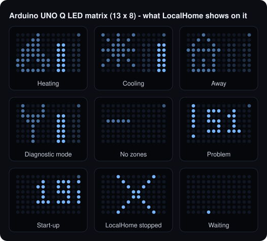
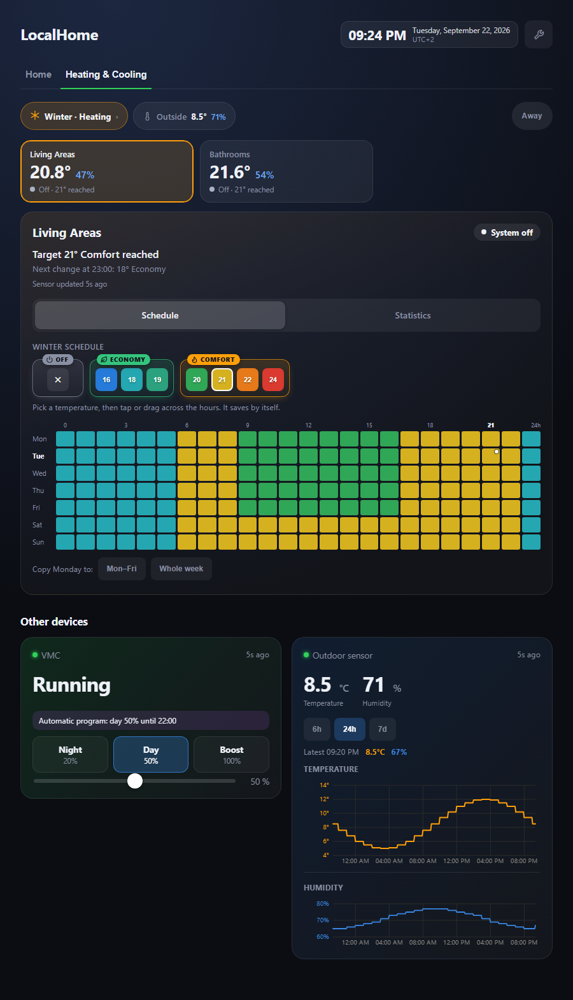
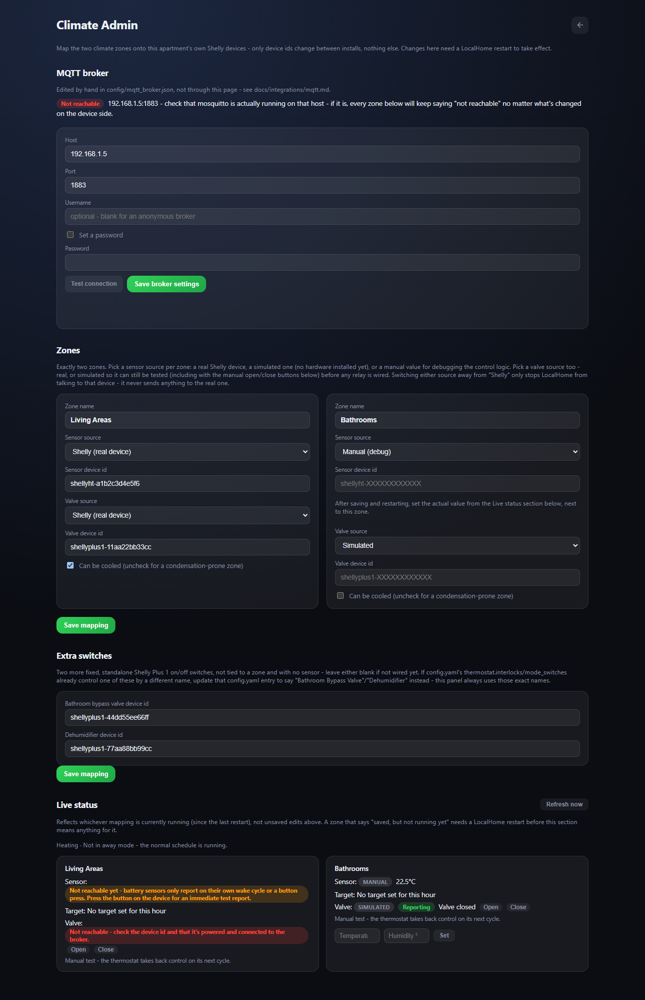

# LocalHome

**Heating, cooling and a home dashboard on an
[Arduino UNO Q](https://www.arduino.cc/product-uno-q)** - local-first: no
hub, no subscription, no cloud between you and your radiators. The
board's Linux side runs everything; its microcontroller turns the LED
matrix on the board into a status display you can read without a phone.



## Built on the Arduino UNO Q

LocalHome is developed on, and runs on, the Arduino UNO Q - and uses both
of its halves:

| Side of the board | What runs there |
|---|---|
| **Linux** - Qualcomm QRB2210, Debian 13 | LocalHome itself: the dashboard, the admin panel, the thermostat and its schedules, statistics, the SQLite history. Next to it, the Mosquitto MQTT broker the Shelly devices report to, and avahi, which makes the board reachable as `<name>.local`. |
| **Microcontroller** - STM32U585 | A small sketch ([deploy/led-matrix](deploy/led-matrix/localhome_matrix/localhome_matrix.ino)) that draws LocalHome's status on the 13x8 LED matrix, fed through the board's own Linux-to-MCU bridge, `arduino-router`. |

The climate devices are Shelly: H&T Gen3 temperature/humidity sensors,
Plus 1 relays on the valves, a 0/1-10V Dimmer Gen3 for the ventilation
(VMC). They talk MQTT to the broker on the board, by the board's name -
nothing depends on an IP address, so the router is free to move it.

What it costs the board, measured on a 2 GB UNO Q:

| | |
|---|---|
| LocalHome's memory | about 73 MB, flat once warmed up |
| CPU | about 0.5% of one core, LED matrix included |
| eMMC writes | about 0.4 GB/day, after [`deploy/tune-board.sh`](deploy/tune-board.sh) |
| Power-on to dashboard | about 40 seconds |

Two boards run it today: one controlling an apartment's radiant heating
and cooling, a second going into field testing in another apartment.

## The LED matrix

The dashboard shows everything to someone with a phone. The matrix is
for whoever is standing in front of the board without one - and above
all for when the network or LocalHome itself is down, which is exactly
when the dashboard can't help. So it shows health, not data:

- **Normal** - the season (flame or snowflake), or away (a house) or
  diagnostic mode (a wrench), and one bar per zone: bright while its
  valve is open, dim while it's closed.
- **A problem** - a blinking `!` and a two-character code, taking turns
  with the normal screen: `S1` zone 1's sensor is silent, `V2` zone 2's
  valve isn't answering, `MQ` the MQTT broker is down, `DK` the disk is
  nearly full, and a few more.
- **Start-up** - the board's IP address scrolls past once, for the day
  `<name>.local` doesn't resolve.
- **Heartbeat** - the top-right pixel blinks with every frame: LocalHome
  is alive.
- **Drawn by the microcontroller on its own** - a dot running along the
  bottom until LocalHome starts, and a blinking X if LocalHome stops
  sending for 20 seconds: stopped, crashed or hung.

It's built to cost nothing that matters: one frame a second over a
single connection to the bridge, its state read from memory every 30
seconds, and nothing at all on a machine without a matrix. The admin
panel's **LED matrix** section has a live mirror of it, a legend drawn by
the same code that drives the LEDs, and every problem code explained.
Setting it up is step 11 of the
[quick installation guide](docs/quick-installation-arduino-uno-q.md).

## Screenshots

All of them captured against the `simulated` driver and example device
ids - no real hardware needed to see this for yourself.

| Home | Heating & Cooling |
|---|---|
|  |  |


*A zone's statistics: when the system ran, and what it did.*


*Climate admin panel - see [below](#the-shelly-climate-admin-panel).*

## Install on an Arduino UNO Q

From a board fresh out of its box to a running installation in about 15
minutes. The full, verified walk-through - every command, what it
prints, and what to do when it doesn't - is
**[docs/quick-installation-arduino-uno-q.md](docs/quick-installation-arduino-uno-q.md)**.
In short, with the board on your Wi-Fi and its name set (Arduino App Lab
does both at first boot), over `ssh arduino@<name>.local`:

```bash
# 1. Time zone - the board ships in UTC, and schedules run on its clock
sudo timedatectl set-timezone Europe/Rome

# 2. Packages
sudo apt-get update
sudo apt-get install -y mosquitto python3.13-venv libnss-mdns

# 3. The MQTT broker, open to the Shelly devices on the LAN
printf 'listener 1883\nallow_anonymous true\n' | sudo tee /etc/mosquitto/conf.d/localhome.conf
sudo systemctl restart mosquitto

# 4. LocalHome
git clone https://github.com/intilinux-eng/LocalHome.git ~/localhome && cd ~/localhome
python3 -m venv .venv && .venv/bin/pip install -e .

# 5. An empty configuration - devices are added from the admin panel
printf 'web:\n  host: "0.0.0.0"\n  port: 5000\n  language: "it"\n\nintegrations: []\n' > config/config.yaml
printf '{\n  "host": "localhost",\n  "port": 1883\n}\n' > config/mqtt_broker.json
.venv/bin/localhome-cli doctor

# 6. Start it at every boot
sed "s/YOUR_USER/$USER/g" deploy/localhome.service | sudo tee /etc/systemd/system/localhome.service > /dev/null
sudo systemctl daemon-reload && sudo systemctl enable --now localhome

# 7. Tune the board for years of unattended running on its eMMC
sudo sh deploy/tune-board.sh

# 8. The LED matrix: the sketch's library (only if `arduino-cli lib list`
#    doesn't show it already), then build and load it - one build at a time
arduino-cli lib install "Arduino_RouterBridge@0.4.3"
arduino-cli compile --upload -b arduino:zephyr:unoq deploy/led-matrix/localhome_matrix
```

Then open `http://<name>.local:5000/climate-admin`: name the page, set
up the two zones - they start simulated, so the whole system can be
tried before any hardware is installed - and switch each device to its
Shelly id as it goes in. On each Shelly: MQTT server `<name>.local:1883`,
"Generic status update over MQTT" on. Limits, tuning and what to expect
over years of unattended running:
[docs/arduino-uno-q.md](docs/arduino-uno-q.md).

## Try it on a PC

The generic steps, to try LocalHome on any computer with the example
devices:

```bash
git clone https://github.com/intilinux-eng/LocalHome.git && cd LocalHome
python3 -m venv .venv
.venv/bin/pip install --upgrade pip
.venv/bin/pip install -e .

cp config/config.example.yaml config/config.yaml
# ...and the *.example.json files you need - see docs/configuration.md
# and docs/integrations/ for each device's own ids/keys/credentials.

.venv/bin/localhome-cli doctor   # sanity-checks config.yaml
.venv/bin/localhome
# -> dashboard at http://localhost:5000
```

Not on a UNO Q? Any other Linux board (a Raspberry Pi, ...) runs it too -
the LED matrix just stays off. See
[docs/deployment.md](docs/deployment.md) for the full walkthrough,
including mosquitto, systemd (so it survives a reboot), and a Docker
alternative. Hit `externally-managed-environment` or "ensurepip is not
available"? See [docs/troubleshooting.md](docs/troubleshooting.md) -
both are one-line fixes.

**Using Shelly devices?** Skip editing `config.yaml` by hand and use
`/climate-admin` from the dashboard instead - see
[docs/configuration.md#the-shelly-climate-admin-panel](docs/configuration.md#the-shelly-climate-admin-panel).

Nothing under `config/` other than the `*.example.*` files is ever
meant to be committed - see [.gitignore](.gitignore). That's what keeps
your own device inventory, API keys and account passwords out of git
while this framework itself stays fully public.

## What's included

| Kind          | Driver                | Talks to                          | Local? |
|---------------|------------------------|------------------------------------|--------|
| `cover`       | `tuya_curtain_switch`  | Tuya-based curtain switches (e.g. LoraTap WiFi roller shutter modules) | Yes (LAN) |
| `climate`     | `tuya_air_quality`     | Tuya 9-in-1/12-in-1 air-quality sensors | Yes (LAN) |
| `power_meter` | `ewelink_powct`        | Sonoff POWCT power-monitoring relay | No - eWeLink cloud only, see [docs/integrations/ewelink.md](docs/integrations/ewelink.md) |
| `switch`      | `meross_plug`          | Meross smartplugs                  | No - Meross cloud (MQTT), see [docs/integrations/meross.md](docs/integrations/meross.md) |
| `switch` / `number` | `tplink_led_strip` | TP-Link Kasa/Tapo LED strips (on/off + brightness) | Yes (LAN) - see [docs/integrations/tplink.md](docs/integrations/tplink.md) |
| `cover` / `climate` / `power_meter` / `switch` / `number` | `mqtt_json` | **Generic** - any device that publishes JSON (or plain-string) state over MQTT: Shelly, Tasmota, Zigbee2MQTT, ESPHome, DIY sketches... | Yes (LAN, to your own broker) - see [docs/integrations/mqtt.md](docs/integrations/mqtt.md) |
| `climate` / `switch` | `simulated`       | **No hardware required** - a fake sensor/switch for trying out the dashboard (or a whole thermostat setup) before you own the real thing | N/A - see [docs/integrations/simulated.md](docs/integrations/simulated.md) |
| `notifier`    | `telegram`             | Telegram bot API                   | Cloud by nature (push notifications) |

`number` is a controllable analog value - a dimmer, a fan speed, a 0-10V
output - for anything set to a level rather than toggled or driven
open/closed.

The dashboard has two tabs: **Home** (your enabled devices, estimated
cover position, sqlite-backed history/charts, an optional power-budget
alert) and **Heating & Cooling** (a multi-zone valve thermostat - a
click-and-drag weekly schedule, run statistics, a one-tap away mode, a
zone that can opt out of one mode entirely, and switch-follows-switch
interlocks - see
[docs/configuration.md#thermostat-heatingcooling-zones](docs/configuration.md#thermostat-heatingcooling-zones)).
Both support optional HTTP Basic Auth and a switchable UI language
(English and Italian ship today - see
[docs/configuration.md#language](docs/configuration.md#language)).

Don't own any of the devices above? Adding your own driver is a
self-contained, half-hour change - see
[docs/adding-a-driver.md](docs/adding-a-driver.md).

## The Shelly climate admin panel

A dedicated `/climate-admin` page for redeploying the same two-zone
thermostat to a new home that standardizes on the
[Shelly](https://www.shelly.com/) device family - map each zone's
sensor/valve, the MQTT broker, and an outdoor sensor to that home's own
device ids from the browser, no `config.yaml` editing. Simulated/manual
test modes let the whole control loop be verified before any relay is
wired, and a live status view gives plain-language guidance instead of
raw error codes. See
[docs/configuration.md#the-shelly-climate-admin-panel](docs/configuration.md#the-shelly-climate-admin-panel)
for the full picture.

## Tested hardware

Driver *code* should work with any device of the right product
category/protocol version, but here's specifically what this project
runs against day to day:

| Device | Driver | Details |
|--------|--------|---------|
| **Arduino UNO Q** (2 GB and 4 GB) | the platform itself | Debian 13 on the Linux side, the `arduino:zephyr` 1.0.0 core on the microcontroller (the LED matrix sketch). Two boards running continuously. |
| LoraTap WiFi Roller Shutter Switch | `tuya_curtain_switch` | Tuya "Curtain switch" product (`product_id nnfrmb3val45av1n`, model `qcsc500wv2n2`), category `clkg`, tinytuya protocol v3.4. Several units running continuously. |
| A Tuya 9-in-1 air-quality/climate sensor | `tuya_air_quality` | Product family "9in1/12in1/14in1" (model `QTF-A+C`, `product_id b7alv1ety7u19i9d`), category `hjjcy`, tinytuya protocol v3.5. |
| Sonoff POWCT power-monitoring relay | `ewelink_powct` | Via the eWeLink cloud v2 API - see [docs/integrations/ewelink.md](docs/integrations/ewelink.md) for why this one isn't local. |
| Meross MSS310 smartplug (energy monitoring) | `meross_plug` | Via the official `meross-iot` library (HTTP login + MQTT), using its `ElectricityMixin` for live power/voltage/current. |
| Shelly H&T Gen3 (battery temperature/humidity sensor) | `mqtt_json` | Two topics (`status/temperature:0`, `status/humidity:0`) merged into one reading via a list `state_topic`, plus its `status/devicepower:0` (battery %) and `status/wifi` (signal strength) components - see [docs/integrations/mqtt.md](docs/integrations/mqtt.md). |
| Shelly Plus 1 (relay, mains-powered) | `mqtt_json` | The generic Gen2+ JSON-boolean shape (`status/switch:0`/`command/switch:0`) - used for both zone valves and the climate admin panel's two extra switches. |
| Shelly 0/1-10V Dimmer Gen3 | `shelly_light` | Doesn't publish a retained status topic like the devices above - actively polled via RPC (`Light.GetStatus`/`Light.Set`) instead; see "Shelly components without a retained status topic" in [docs/integrations/mqtt.md](docs/integrations/mqtt.md). |

If you run a driver against different hardware in the same product
family and it works (or doesn't), a PR adding a row here - or opening an
issue with the model/product_id - is genuinely useful to the next
person.

## How it's organized

```
config/            Your device inventories, secrets and config.yaml (gitignored, except *.example.*)
src/localhome/
  core/            Driver interfaces, the plugin registry, background pollers
  drivers/         One subpackage per brand/protocol (tuya, ewelink, meross, mqtt, simulated, notifiers, ...)
  services/        Cross-driver logic: cover position estimation, sqlite history + alerting, the heating/cooling thermostat, and its switch-follows-switch interlock
  web/             Flask app (+ optional Basic Auth), dashboard templates/static files, and locales/ (UI language files, see docs/configuration.md#language)
  config.py        Loads config.yaml and resolves its relative paths
  cli.py           Command-line cover control
docs/              Full documentation (see below)
tests/             Hardware-independent unit tests
deploy/            systemd unit, board tuning, the LED matrix sketch, the resource log; see also Dockerfile/docker-compose.yml at the repo root
```

See [ARCHITECTURE.md](ARCHITECTURE.md) for how these pieces fit together
and why they're split this way.

## Documentation

- [docs/quick-installation-arduino-uno-q.md](docs/quick-installation-arduino-uno-q.md) - a new Arduino UNO Q from the box to a running installation, LED matrix included, step by step
- [docs/arduino-uno-q.md](docs/arduino-uno-q.md) - the reference installation: Arduino UNO Q, Shelly-only climate control, limits, tuning, updating
- [ARCHITECTURE.md](ARCHITECTURE.md) - the driver/registry/manager design and why it looks like this
- [docs/configuration.md](docs/configuration.md) - full config.yaml reference, including optional web auth
- [docs/adding-a-driver.md](docs/adding-a-driver.md) - how to add a new brand or device kind
- [docs/integrations/](docs/integrations/) - per-brand setup guides (Tuya, eWeLink, Meross, MQTT, Telegram, Simulated)
- [docs/deployment.md](docs/deployment.md) - Docker / systemd for running this unattended
- [docs/troubleshooting.md](docs/troubleshooting.md) - known error messages and fixes
- [CONTRIBUTING.md](CONTRIBUTING.md) - how to propose changes, coding conventions
- [THIRD_PARTY_NOTICES.md](THIRD_PARTY_NOTICES.md) - dependency licenses and a note on the eWeLink driver

## Why this exists

Cloud-dependent smart-home apps break when the vendor's server has a bad
day, get discontinued when the vendor loses interest, and generally cost
more (subscriptions, hub hardware) than the gadgets they control. Most
cheap WiFi devices already speak a local protocol under the hood -
projects like [tinytuya](https://github.com/jasonacox/tinytuya) simply
expose it. LocalHome is the smallest structure that lets several such
devices, from different brands, show up on one dashboard and share one
history/alerting story, while staying easy enough to read that adding
"one more sensor" stays a small change instead of a rewrite.

## Legal & licensing

LocalHome is [MIT licensed](LICENSE). Its dependencies are permissive
(MIT/BSD/Apache) except `python-kasa` (GPL-3.0-or-later) - it's only
pulled in if you opt into the `tplink_led_strip` driver's own
`[tplink]` extra, never by a plain install - see
[THIRD_PARTY_NOTICES.md](THIRD_PARTY_NOTICES.md#a-note-on-python-kasa-specifically)
for what that means in practice. The `ewelink_powct` driver separately
relies on unofficial, reverse-engineered eWeLink app credentials (the
same pattern [AlexxIT/SonoffLAN](https://github.com/AlexxIT/SonoffLAN)
uses) - not sanctioned by Coolkit/eWeLink; skip that one integration if
that's not a tradeoff you want. See
[THIRD_PARTY_NOTICES.md](THIRD_PARTY_NOTICES.md#a-note-on-the-ewelink-driver-specifically)
for the full explanation either way.

This project is not affiliated with, endorsed by, or sponsored by Tuya,
LoraTap, Sonoff, Coolkit/eWeLink, Meross, or Telegram. All trademarks
belong to their respective owners.
