# A tour of LocalHome

These pictures come from **a real home in Turin**, from the board that has
run its climate since October 2026: the data, the charts and the history are
real. The pages are in Italian, the home's language; LocalHome also speaks
English. Before the pictures were taken, everything private was replaced:
the devices' ids and MAC addresses, the IP addresses, the Wi-Fi network, the
board's name and serial, a person's name in a shutter's
([`tools/screenshot_board.py`](../tools/screenshot_board.py) does it and
checks it).

There are two pages and two apps:

| Where | For whom | What it is for |
|---|---|---|
| [The home page](#the-home-page) | the people who live in the house | the temperature of each zone, its program, the VMC, the shutters |
| [The admin panel](#the-admin-panel) | the installer | the season, the devices, the settings, the board's health |
| [The desktop apps](#the-desktop-apps) | anyone at a PC | the house in a window, with a tray icon and notices |

## The home page

Open `http://<board>.local:5000` on a phone or a PC. Each zone shows its
temperature and humidity, how comfortable it is, its target and what the
program does next. The top says in one line what the house does now.

| On a phone | In the dark |
|---|---|
| 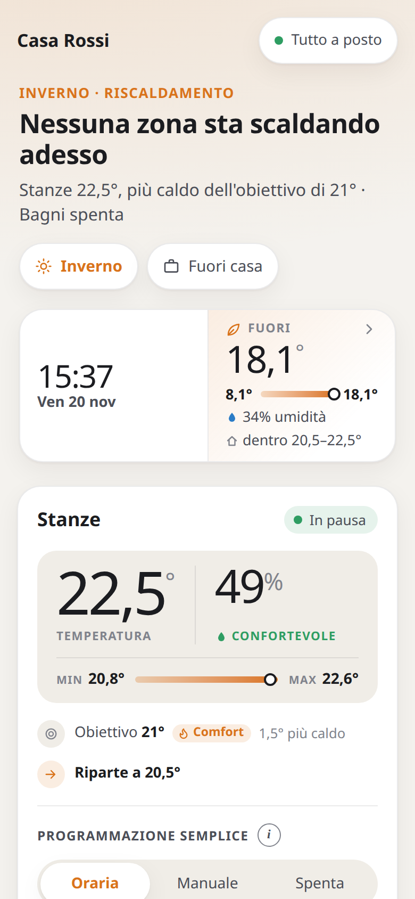 | 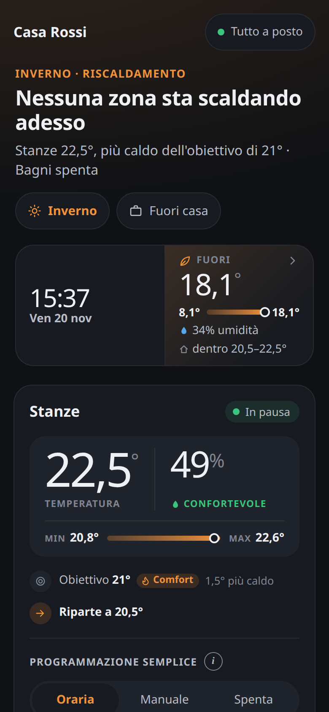 |

On a PC the zones sit side by side, each with its week painted by the hour:
tap or drag over the hours to change the program.

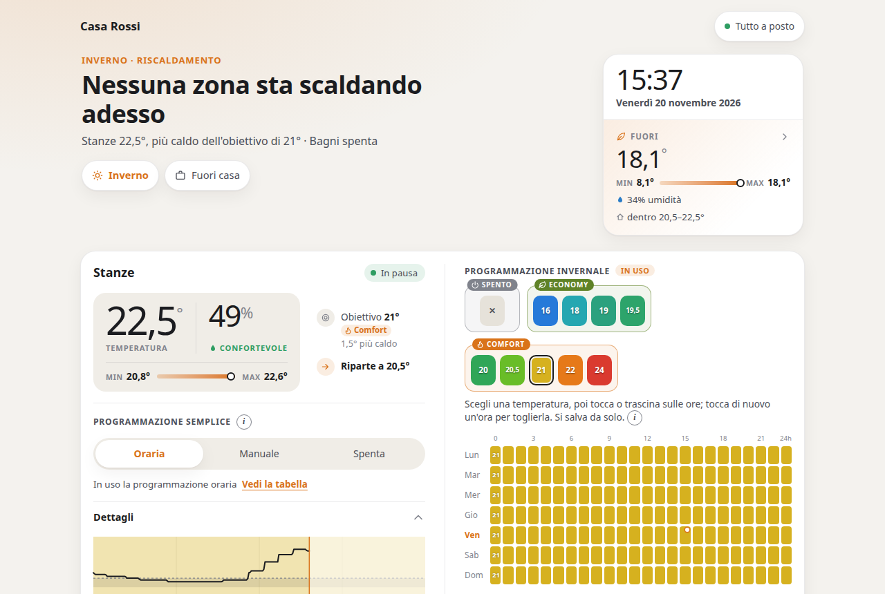

A zone's details: its last 24 hours with the valve's openings, its lowest and
highest of each day, its hours of heating.

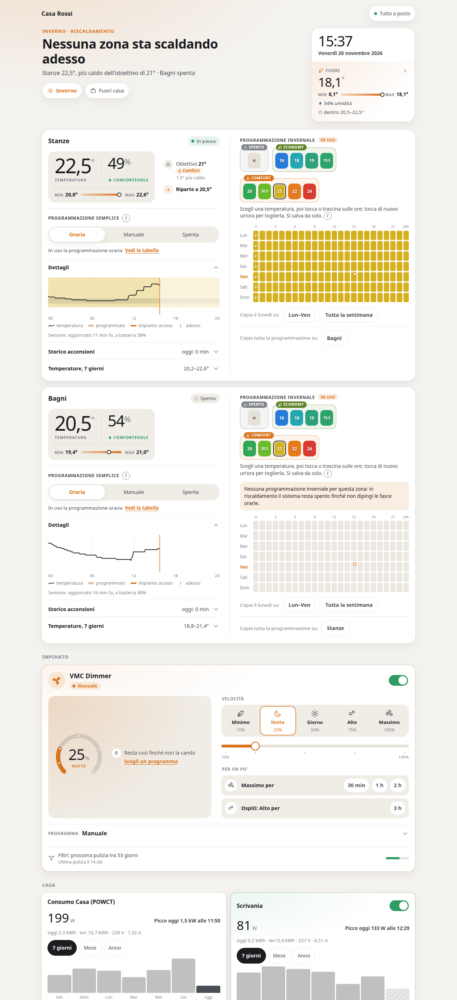

## The admin panel

Open `http://<board>.local:5000/climate-admin`. It is for the installer: the
top tells in six tiles whether the installation is fine; each section below
tells its state in its title, so nobody has to open it to know.

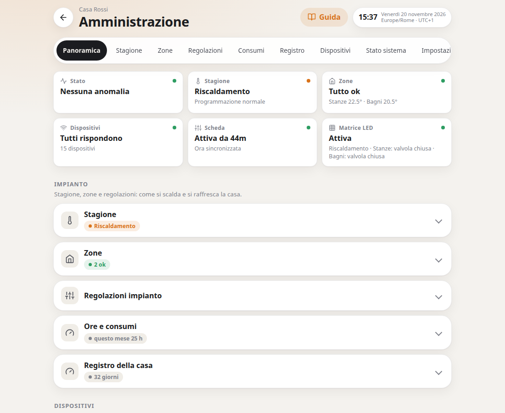

### Season

Heating or cooling, set by hand when the central plant changes season. What
the season does to the bathroom bypass valve and to the dehumidifier, and a
check that they really do it.

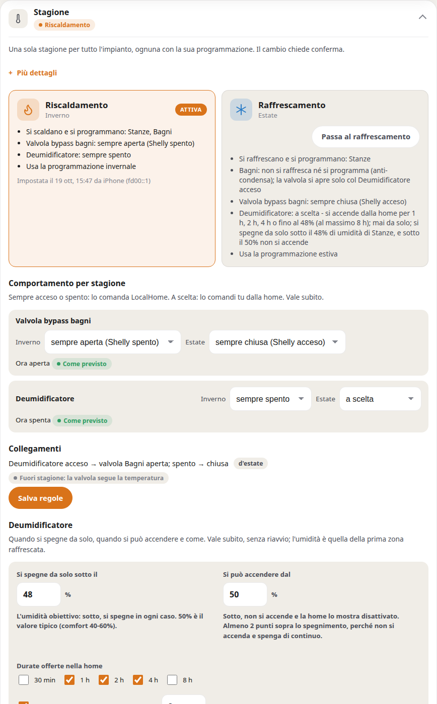

### Zones

The two zones and their devices: which sensor and which valve, Shelly or
simulated. Below, what each one reads now.

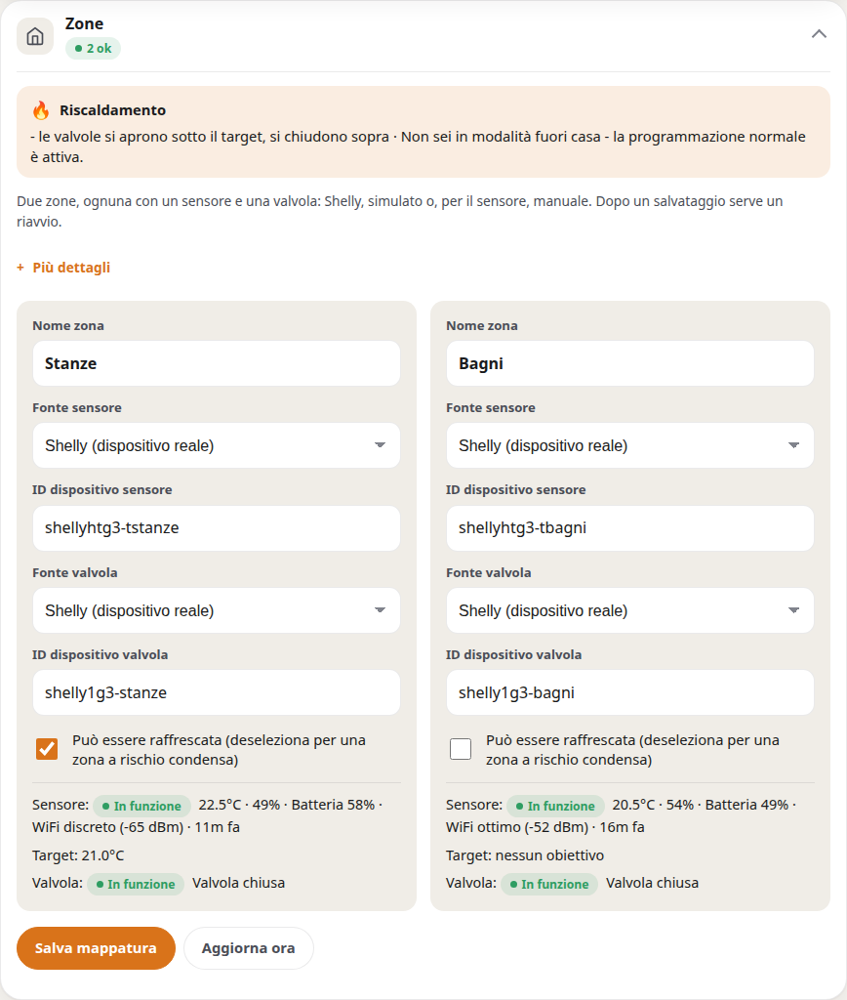

### Plant settings

The thermostat's numbers: the hysteresis, the economy tolerance, frost
protection, the safety close when a sensor stops. The VMC's speeds, its
automatic adjustments and its filters. Each value says where it comes from.

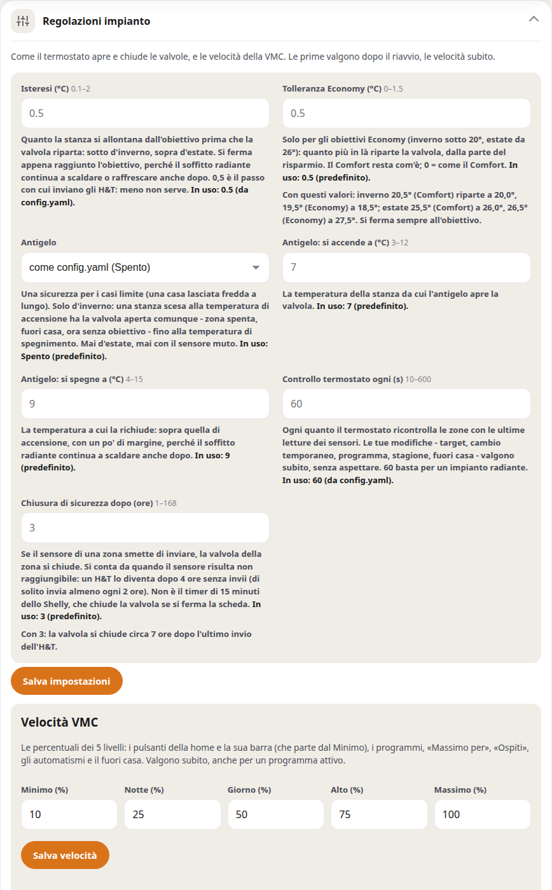

### Hours and consumption

Month by month: the hours each zone heated or cooled, the outdoor mean and the
degree days, and the heat meter's kWh when you type its readings in.

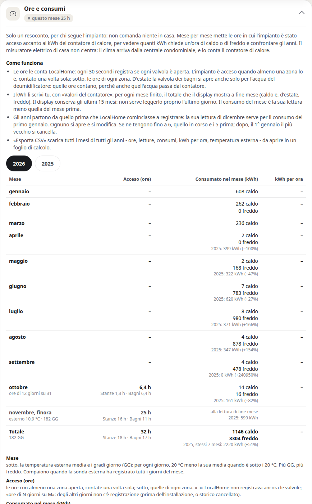

### House record

A 5-minute record of the whole house, kept six years, to download for
analysis.

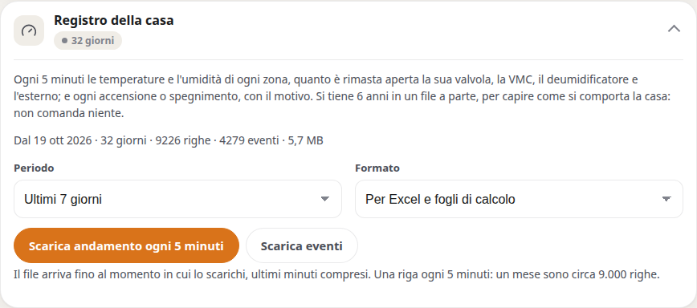

### Devices

Every device LocalHome reads or drives, those that don't answer first, each
with its signal, battery and last report. A Shelly opens on what it says
about itself. Below, the devices that don't belong to a zone.

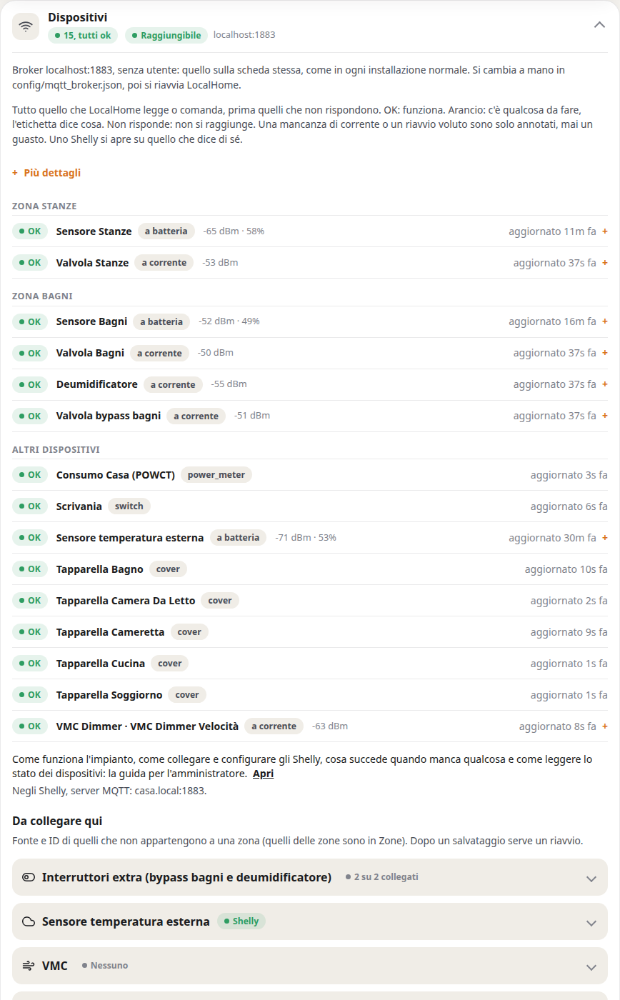

### System status

The board itself: what is wrong (nothing, here), the LED matrix as it shows
now, the process, the board's memory and temperature, the network, the
protections for running unattended, the last starts and what the watchdogs
did.

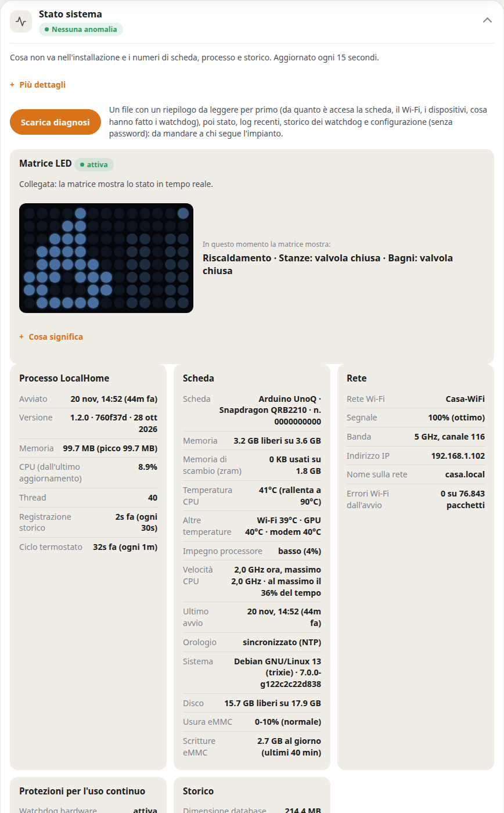

### Settings

The page's name and language, how long the history is kept and how big it may
grow.

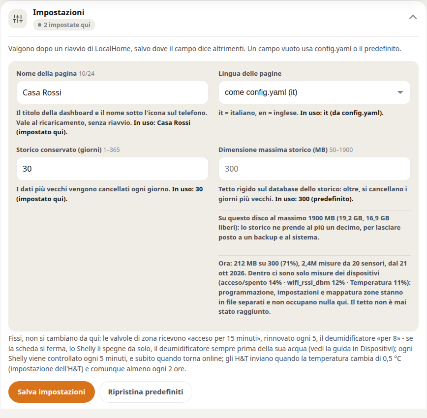

### Diagnosis and maintenance

The diagnostic mode, to test each valve by hand, and the backups of the
history.

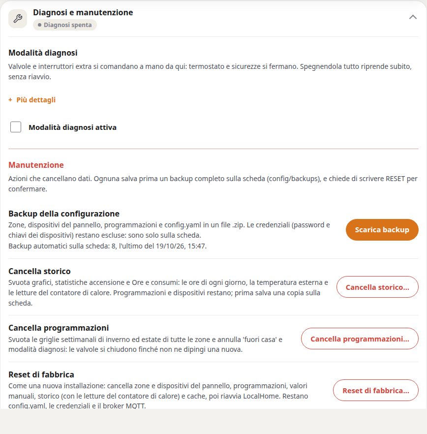

## The desktop apps

The house in a window beside your other programs, with a tray icon that shows a
temperature and turns amber when something needs a look, and a notice when a
zone turns on or the board can't be reached. They use only the board's
existing API: nothing on the board changes.

On **Linux** (KDE and the other desktops), the Debian package from the
[releases](https://github.com/intilinux-eng/LocalHome/releases):

| A narrow window | A wide one: the charts beside the house |
|---|---|
| 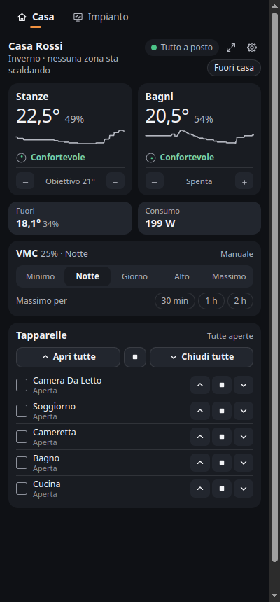 | 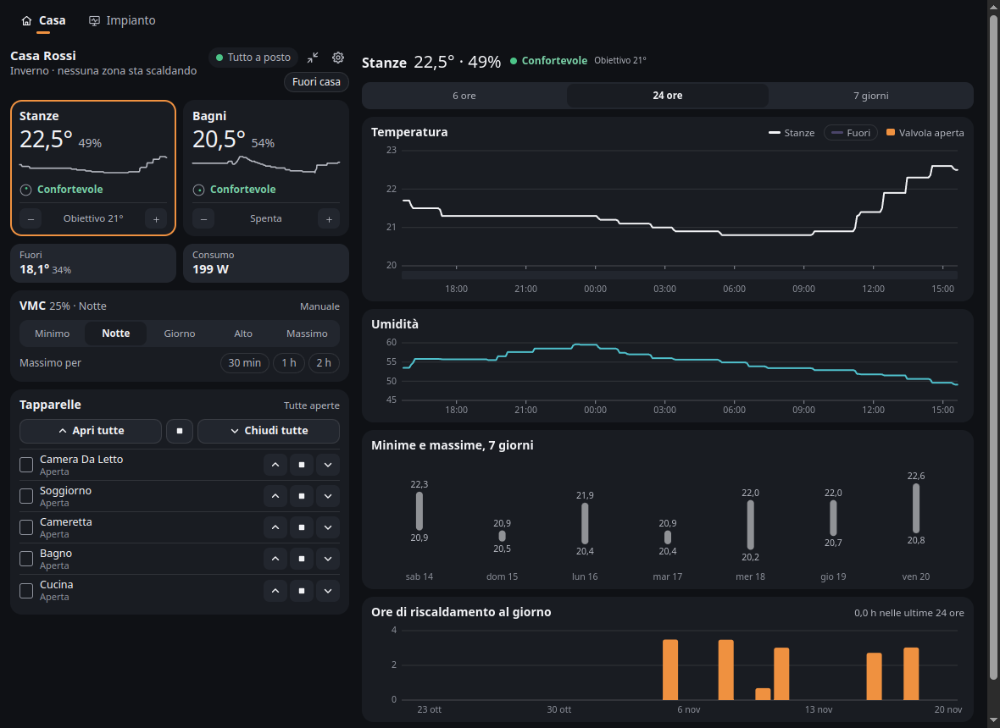 |

The second tab, **Impianto**, is for the installer: a verdict, the devices by
zone with their signal and battery, and the main settings, read only.

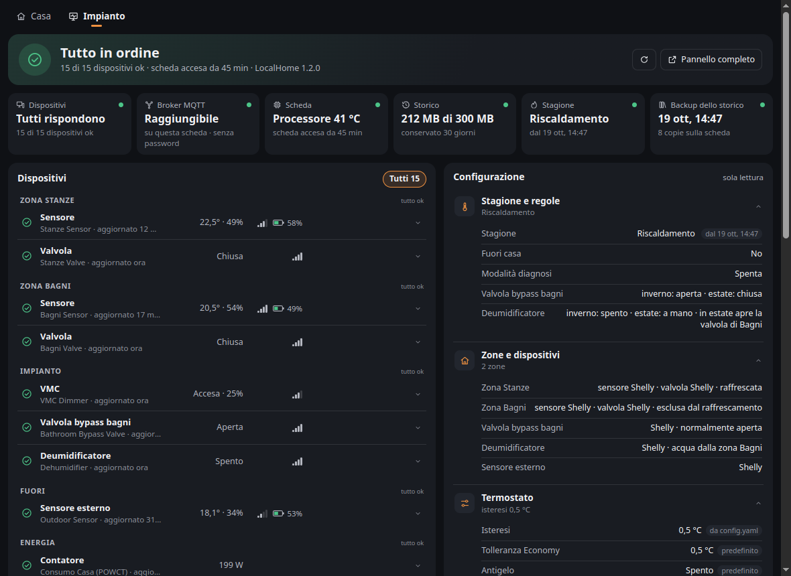

On **Windows**, `LocalHome-Setup.exe` from the same releases: the same page,
with Windows 11's look and its notices. It installs for the user, with no
administrator rights.

How the apps work: [desktop/README.md](../desktop/README.md).
